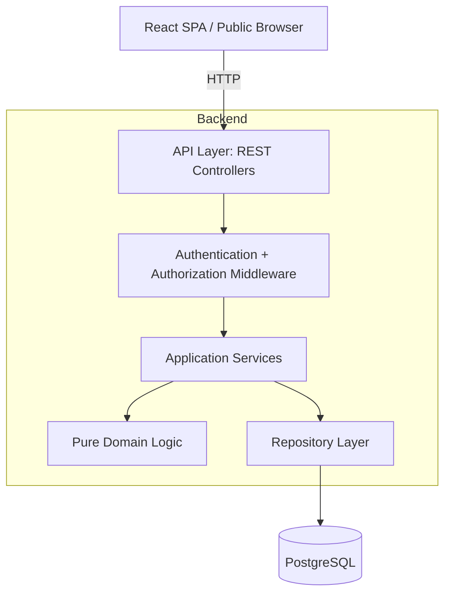
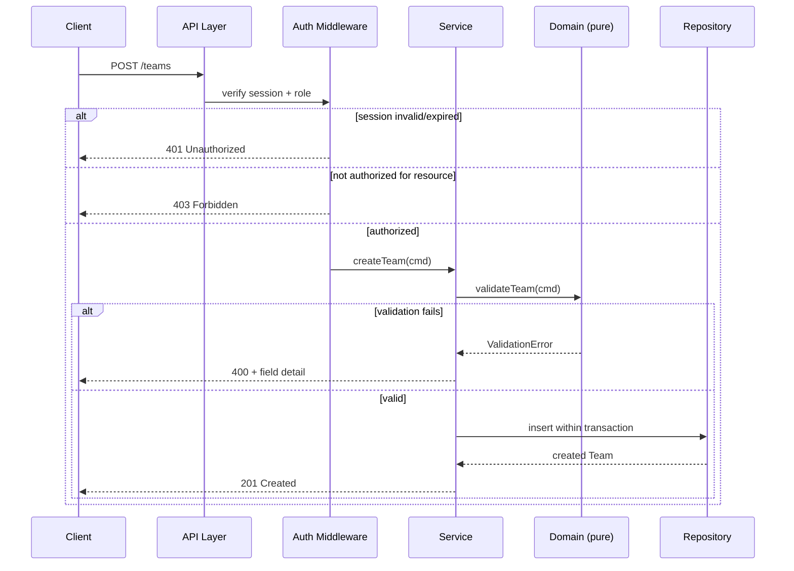
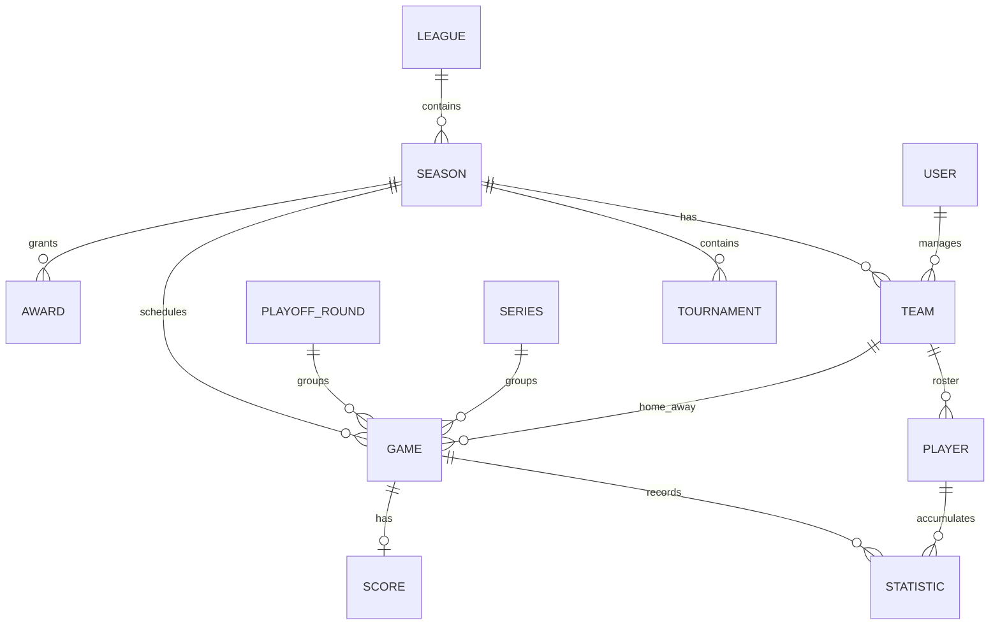

# Design Document

## Overview

Ang Basketball League Management System ay isang web application para sa pag-oorganisa at pagpapatakbo ng basketball leagues. Sinasaklaw nito ang authentication, role-based access control (Administrator, Team_Manager, Viewer), pamamahala ng Teams at Players, manual at automatic na game scheduling, score recording, standings calculation, statistics tracking, season at tournament management (kasama ang playoffs at best-of-N series), batch upload, at auto-computed na Awards.

Ang design na ito ay tumutugon sa lahat ng 13 requirements. Ang core ng sistema ay isang pares ng deterministikong domain algorithms — standings tiebreaker resolution, round-robin schedule generation na may fair distribution, batch upload validation, at awards computation — na dinisenyo bilang pure functions para madaling ma-property-test.

### Design Goals

- **Deterministic domain logic**: Lahat ng ranking, tiebreaker, at award computation ay deterministic at reproducible para sa parehong input.
- **Separation of concerns**: Malinaw na hati sa pagitan ng transport (HTTP/API), application services, at pure domain logic.
- **Testability**: Ang mga business rules ay nakalagay sa pure functions na independent sa database at HTTP, para ma-test bilang universal properties.
- **Least-privilege access**: Bawat mutating operation ay dumadaan sa Authorization_Service bago mag-mutate ng data.

### Key Design Decisions

| Desisyon | Rationale |
|----------|-----------|
| Layered architecture (API → Service → Domain → Repository) | Pinaghihiwalay ang I/O sa business logic; ang domain layer ay pure at property-testable (tumutugon sa Requirement 8's separation concern). |
| Pure domain functions para sa standings, scheduling, awards | Ang mga ito ang pinaka-error-prone na parts; pure functions = deterministic at testable sa 100+ generated inputs. |
| Relational database (PostgreSQL) | Ang domain ay malinaw na relational (foreign keys sa League→Season→Team→Player→Game→Statistic); kailangan ng transactional integrity para sa all-or-nothing batch upload. |
| Server-side session tokens na may sliding expiry | Direktang tumutugon sa Requirement 1's 30-minute inactivity at lockout rules. |
| Draft schedule bilang hiwalay na state, hindi visible sa Viewers | Tumutugon sa Requirement 12's draft-then-submit workflow. |

## Architecture

### Technology Stack

Dahil greenfield na web application ito (walang existing code sa workspace maliban sa spec), ito ang iminumungkahing stack. Maaari itong palitan base sa preference ng user.

- **Frontend**: React + TypeScript (SPA), na kumokonsumo ng REST API.
- **Backend**: Node.js + TypeScript na may Express (o Fastify) para sa REST API.
- **Database**: PostgreSQL, na-access sa pamamagitan ng isang typed query layer (hal. Prisma o Drizzle ORM).
- **Authentication**: Server-side sessions na may signed session tokens (HTTP-only cookies), bcrypt para sa password hashing.
- **File parsing**: Isang CSV parser at isang .xlsx parser (hal. `csv-parse` at `xlsx`/`exceljs`) para sa Batch_Upload.
- **Testing**: Vitest/Jest para sa unit tests, at `fast-check` para sa property-based tests.

### Layered Architecture



**Responsibilities per layer:**

- **API Layer**: HTTP routing, request parsing, response serialization, status codes. Walang business logic.
- **Auth Middleware**: Nagve-verify ng session (Authentication_Service) at nag-e-enforce ng role/team access (Authorization_Service) bago maabot ang service.
- **Application Services**: Nag-o-orchestrate ng use cases; nag-co-coordinate ng repositories at transactions; tumatawag sa pure domain functions.
- **Pure Domain Logic**: Deterministikong algorithms na walang I/O — standings, schedule generation, batch validation, awards. Ito ang property-tested na core.
- **Repository Layer**: Data access at persistence, kasama ang transactional (all-or-nothing) operations.

### Request Flow: Mutating Operation



## Components and Interfaces

### Authentication_Service (Requirement 1)

Namamahala ng credential verification, session lifecycle, at account lockout.

```typescript
interface AuthenticationService {
  signIn(username: string, password: string): Promise<SignInResult>;
  signOut(sessionId: string): Promise<void>;
  validateSession(sessionId: string): Promise<SessionState>; // sliding 30-min expiry
}

type SignInResult =
  | { ok: true; session: Session }
  | { ok: false; reason: 'invalid_credentials' | 'missing_field' | 'account_locked'; detail: string; remainingLockMs?: number };
```

Design notes:
- Password hashes gamit ang bcrypt; hindi kailanman inihahayag kung username o password ang mali (Req 1.3).
- Failed attempts tinatrack sa isang rolling 15-minute window; >5 failures → 15-min lock (Req 1.6).
- Session ay may `lastActivityAt`; ang bawat authenticated request ay nagre-refresh nito; kapag lumagpas sa 30 min na inactivity, ang session ay tinuturing na expired (Req 1.2).

### Authorization_Service (Requirement 2)

Nag-e-enforce ng role-based at team-scoped access.

```typescript
interface AuthorizationService {
  authorize(user: AuthUser, action: Action, resource: ResourceRef): AuthDecision;
}

type Role = 'Administrator' | 'Team_Manager' | 'Viewer';
type AuthDecision = { allowed: true } | { allowed: false; reason: string };
```

Rules:
- Exactly one primary role bawat user (Req 2.1). Kapag walang role → deny lahat (Req 2.5).
- Team_Manager ay pwedeng mag-modify lamang ng assigned teams (Req 2.2, 4.4).
- Viewer ay tinatanggihan sa lahat ng create/update/delete (Req 2.3).
- Administrator ay may full CRUD (Req 2.4).

### TeamService (Requirement 3)

`createTeam`, `updateTeam`, `deleteTeam`. Nagva-validate ng name length (1–100), season existence, at case-insensitive duplicate name sa loob ng season. Pinipigilan ang pag-delete ng team na may ≥1 completed Games.

### PlayerService / RosterService (Requirement 4)

`addPlayer`, `updatePlayer`, `removePlayer`. Nagva-validate ng name length (1–100), jersey number (0–99), at uniqueness ng jersey number sa loob ng team roster. Team-scoped authorization.

### SchedulingService (Requirements 5, 12)

- Manual: `createGame`, `rescheduleGame`, `cancelGame` — na may venue overlap conflict detection at future-date validation.
- Automatic: `generateSchedule` (draft), `regenerateSchedule`, `assignVenueAndTime`, `submitDraftSchedule` — tumatawag sa pure `roundRobinPairings` at `distributeGames` domain functions.

### ScoringService (Requirement 6)

`recordScore` (initial, minamarkahan ang game bilang completed), `correctScore` (para sa completed games). Nag-t-trigger ng standings recalculation.

### StandingsService (Requirement 7)

`computeStandings(seasonId)` → tumatawag sa pure `rankTeams` domain function. Sinu-store ang final standings snapshot kapag na-close ang season (Req 10.5).

### StatisticsService (Requirement 8)

`recordStatistic`, `getPlayerSeasonStats`, `getTeamSeasonStats`. Nag-e-enforce ng 6-type enum, non-negative integer (0–999), at player eligibility sa game.

### SeasonTournamentService (Requirement 9)

`createSeason`, `createTournament`, `createPlayoffGame`, `createSeries`, `closeSeason`. Nagva-validate ng date ordering, formats, playoff rounds, at best-of-N.

### BatchUploadService (Requirement 11)

`uploadTeamsAndPlayers(file)` → nagpa-parse (CSV/xlsx), tumatawag sa pure `validateBatch`, at nag-i-import sa loob ng isang all-or-nothing transaction.

### AwardsService (Requirement 13)

`computeAwards(scopeId)` → tumatawag sa pure `computeRegularSeasonAwards` at `computeFinalsMvp`. `publishAwards`, `getPublishedAwards`.

### Public Browsing Endpoints (Requirement 10)

Read-only endpoints para sa schedule, results, at standings na hindi nangangailangan ng session.

## Data Models



### Entities

```typescript
type StatisticType = 'Points' | 'Assists' | 'Rebounds' | 'Steals' | 'Blocks' | 'Three_Pointers_Made';
type TournamentFormat = 'single-elimination' | 'double-elimination' | 'round-robin';
type PlayoffRoundType = 'Quarterfinals' | 'Semifinals' | 'Finals';
type BestOfN = 3 | 5 | 7;
type GameStatus = 'scheduled' | 'completed' | 'cancelled';
type ScheduleState = 'draft' | 'official';

interface User {
  id: string;
  username: string;
  passwordHash: string;
  role: Role | null;          // null → deny all (Req 2.5)
  managedTeamIds: string[];   // para sa Team_Manager
  failedAttempts: { at: Date }[];
  lockedUntil: Date | null;
}

interface Session {
  id: string;
  userId: string;
  role: Role;
  createdAt: Date;
  lastActivityAt: Date;       // sliding 30-min expiry (Req 1.2)
}

interface League { id: string; name: string; }

interface Season {
  id: string;
  leagueId: string;
  name: string;               // 1–100 chars, unique sa loob ng league
  startDate: Date;
  endDate: Date;              // dapat after startDate
  closed: boolean;
  finalStandingsSnapshot?: StandingRow[]; // recorded kapag closed
}

interface Tournament {
  id: string;
  seasonId: string;
  format: TournamentFormat;
  roundRobinKind?: 'single' | 'double'; // kapag round-robin
}

interface Team {
  id: string;
  seasonId: string;
  name: string;               // 1–100 chars, unique (case-insensitive) sa loob ng season
}

interface Player {
  id: string;
  teamId: string;
  name: string;               // 1–100 chars
  jerseyNumber: number;       // 0–99, unique sa loob ng team roster
}

interface Game {
  id: string;
  seasonId: string;
  homeTeamId: string;
  awayTeamId: string;         // dapat != homeTeamId
  date: Date;
  startTime: string | null;   // null para sa generated draft games (Req 12.10)
  durationMinutes: number | null; // 1–480
  venue: string | null;       // null para sa generated draft games
  status: GameStatus;
  scheduleState: ScheduleState;
  playoffRoundId: string | null; // null → regular season (Req 9.8)
  seriesId: string | null;
}

interface Score {
  gameId: string;
  homeScore: number;          // 0–999 integer
  awayScore: number;          // 0–999 integer
  completedAt: Date;
}

interface Statistic {
  id: string;
  playerId: string;
  gameId: string;
  type: StatisticType;
  value: number;              // 0–999 non-negative integer
}

interface PlayoffRound {
  id: string;
  seasonId: string;
  type: PlayoffRoundType;
}

interface Series {
  id: string;
  playoffRoundId: string;
  teamAId: string;
  teamBId: string;
  bestOf: BestOfN;            // 3, 5, o 7
}

interface StandingRow {
  teamId: string;
  wins: number;
  losses: number;
  rank: number;               // pantay na rank kapag fully tied (Req 7.7)
}

type AwardCategory = 'MVP' | 'Mythical_5' | 'Best_in_3_Pointers' | 'DPOY' | 'Assists_Leader' | 'Finals_MVP';

interface Award {
  id: string;
  scopeId: string;            // season o tournament id
  category: AwardCategory;
  playerIds: string[];        // isa para sa karamihan; lima para sa Mythical 5
  published: boolean;         // hidden hanggang published (Req 13.13–13.15)
}
```

### Derived / Computed Values

- **Points_Ratio**: total points scored / total points allowed mula sa Game Scores (hindi ang per-Player "Points" Statistic). Zero points allowed → treated as higher kaysa sa anumang non-zero ratio (Req 7.5).
- **Combined_Statistic_Total (CST)**: sum ng lahat ng anim na Statistic_Type totals ng player (Req awards).
- **Total_Statistics_Points (TSP)**: Points + Assists + Rebounds + Steals + Blocks (hindi kasama ang Three_Pointers_Made) — para sa Finals MVP.

## Correctness Properties

*A property is a characteristic or behavior that should hold true across all valid executions of a system — essentially, a formal statement about what the system should do. Properties serve as the bridge between human-readable specifications and machine-verifiable correctness guarantees.*

Ang mga property na ito ay galing sa acceptance criteria at pinagsama-sama pagkatapos ng prework reflection para maiwasan ang redundancy. Bawat isa ay isusulat bilang isang property-based test na tumatakbo ng minimum 100 iterations.

#### Category: Authentication and Authorization

### Property 1: Valid sign-in yields a session scoped to the user's role

*For any* registered User with valid credentials and an assigned role, signing in SHALL succeed and return a session whose role equals that User's role.

**Validates: Requirements 1.1**

### Property 2: Session validity follows the 30-minute inactivity rule

*For any* session and any current time, `validateSession` SHALL report the session as active if and only if the elapsed time since last activity is strictly less than 30 minutes and the session has not been signed out.

**Validates: Requirements 1.2, 1.5**

### Property 3: Invalid credentials are rejected without disclosure

*For any* credential pair that does not match a stored User, sign-in SHALL fail, establish no session, and return an error message that is identical regardless of whether the username or the password was the mismatched field.

**Validates: Requirements 1.3, 1.4**

### Property 4: Account lockout obeys the rolling-window rule

*For any* sequence of timestamped failed sign-in attempts, the account SHALL be locked at a given time if and only if more than 5 failures fall within the preceding 15-minute window, and while locked every sign-in attempt SHALL be rejected.

**Validates: Requirements 1.6**

### Property 5: Authorization respects role and team scope

*For any* User and any create/update/delete action on a resource, the Authorization_Service SHALL allow the action if and only if the User is an Administrator, or is a Team_Manager acting on a Team in their managed set; a Viewer or a User with no role SHALL be denied, and denied actions SHALL leave the target resource unchanged.

**Validates: Requirements 2.2, 2.3, 2.4, 2.5, 4.4, 12.1**

#### Category: Teams and Rosters

### Property 6: Team creation validation and association

*For any* Team submission, the System SHALL create the Team and associate it with the given Season if and only if the name length is within 1–100 characters, the Season exists, and no case-insensitive duplicate name exists in that Season; otherwise no Team is created.

**Validates: Requirements 3.1, 3.2, 3.3, 3.4, 3.5**

### Property 7: Team deletion is gated by completed Games

*For any* Team, a delete request SHALL remove the Team if and only if it has zero completed Games; a Team with one or more completed Games SHALL be retained unchanged along with its associated records.

**Validates: Requirements 3.7, 3.8**

### Property 8: Roster add/remove round-trip

*For any* Roster and a valid Player (name 1–100 chars, jersey 0–99) with a jersey number not already on that Roster, adding the Player then removing that same Player SHALL return the Roster to a state not containing the Player, and after the add the Roster SHALL contain exactly that Player in addition to the originals.

**Validates: Requirements 4.1, 4.5**

### Property 9: Roster validation rejects invalid or duplicate Players

*For any* Player add or update, the System SHALL reject the operation and leave the Roster unchanged if the name length is outside 1–100, the jersey number is outside 0–99, or the jersey number duplicates another Player on the same Team; otherwise the valid values are saved.

**Validates: Requirements 4.2, 4.3, 4.7**

#### Category: Scheduling and Scoring

### Property 10: Manual Game creation validation

*For any* Game submission, the System SHALL create the Game with a unique identifier if and only if both Teams are present and distinct, the date/start time is in the future, the duration is within 1–480 minutes, and a Venue is present; otherwise no Game is created.

**Validates: Requirements 5.1, 5.2, 5.3, 5.4**

### Property 11: Venue conflict detection is exactly interval overlap

*For any* Venue with a set of non-cancelled Games and any candidate Game at that Venue, the System SHALL reject the candidate if and only if its interval [start, start + duration) overlaps the interval of at least one existing non-cancelled Game at the same Venue.

**Validates: Requirements 5.5**

### Property 12: Reschedule and cancel state rules

*For any* Game, rescheduling SHALL succeed and save the new schedule only if the Game is not cancelled and the new schedule passes future-date and venue-conflict checks; a cancelled Game SHALL never be rescheduled and retains its schedule; cancelling a scheduled Game SHALL mark it cancelled while retaining the record.

**Validates: Requirements 5.6, 5.7, 5.8**

### Property 13: Score recording marks completion and validates values

*For any* Game not yet completed and any pair of integer scores within 0–999, recording the Score SHALL store both values and mark the Game completed; any score that is negative, non-integer, out of range, or missing SHALL be rejected with the previously recorded Score retained.

**Validates: Requirements 6.1, 6.2**

### Property 14: Completed-Game score correction rule

*For any* Game already marked completed, an initial-score submission SHALL be rejected, while a correction with valid 0–999 integer values SHALL save the updated Score.

**Validates: Requirements 6.4, 6.5**

#### Category: Standings

### Property 15: Standings ranking is total and follows the full comparator

*For any* set of Teams with their Games and Scores, `rankTeams` SHALL produce a deterministic ordering that ranks by wins descending, then losses ascending, then head-to-head wins among the tied Teams, then Points_Ratio descending (treating zero points allowed as the highest ratio), then Team name ascending; Teams identical on every criterion SHALL receive the same rank value, and the same input SHALL always produce the same output.

**Validates: Requirements 7.1, 7.2, 7.3, 7.4, 7.5, 7.6, 7.7**

### Property 16: Standings rows expose wins, losses, and rank

*For any* computed Standings, every rendered row SHALL include the Team's wins, losses, and rank.

**Validates: Requirements 7.8, 10.4**

### Property 17: Closed-Season Standings return the recorded snapshot

*For any* Season that is closed with a recorded final Standings snapshot, subsequent Standings requests SHALL return that snapshot unchanged, independent of later changes to underlying data.

**Validates: Requirements 10.5**

#### Category: Statistics

### Property 18: Statistic store round-trip and eligibility

*For any* valid Statistic (one of the six types, integer value 0–999) recorded for a Player on a Team participating in the completed Game, the stored value SHALL equal the submitted value for that Player, Game, and type; a Statistic for a Player not on either participating Team, or with an invalid value or unsupported type, SHALL be rejected with any previous Statistic retained.

**Validates: Requirements 8.2, 8.3, 8.4, 8.5**

### Property 19: Statistic aggregation equals the sum of contributions

*For any* set of recorded Statistics in a Season, each Player's season total for a given Statistic_Type SHALL equal the sum of that Player's recorded values of that type (zero when none exist), and each Team's season total for a type SHALL equal the sum of its Players' season totals for that type.

**Validates: Requirements 8.6, 8.7, 8.8**

#### Category: Seasons, Tournaments, and Series

### Property 20: Season creation validation

*For any* Season submission, the System SHALL create the Season if and only if the name length is 1–100 characters, the name is unique within the League, and the end date is strictly after the start date; otherwise no Season is created and the specific violation is reported.

**Validates: Requirements 9.1, 9.2, 9.3**

### Property 21: Game classification invariant

*For any* Game, the System SHALL classify it as either regular season (with no Playoff_Round) or as belonging to exactly one Playoff_Round, never both and never neither.

**Validates: Requirements 9.8**

### Property 22: Series best-of-N validation and majority winner

*For any* Series, creation SHALL succeed only when the best-of-N value is 3, 5, or 7; and for any sequence of per-Game winners in a Series of N Games, the Series winner SHALL be the Team that first accumulates more than N/2 Game wins, with no winner declared before that majority is reached.

**Validates: Requirements 9.10, 9.11, 9.12**

### Property 23: Closed Season rejects new Games

*For any* Season marked closed, any attempt to create a Game within that Season SHALL be rejected and no Game SHALL be created.

**Validates: Requirements 9.13**

#### Category: Public Browsing

### Property 24: Schedule ordering and required fields

*For any* Season, the public schedule SHALL list its scheduled Games ordered by date then start time ascending, and each entry SHALL include date, start time, Venue name, and both participating Teams.

**Validates: Requirements 10.1**

### Property 25: Results expose scores and completion date

*For any* Season, the results view SHALL list every completed Game showing both Teams' final Scores and the date the Game was completed.

**Validates: Requirements 10.3**

#### Category: Batch Upload

### Property 26: Batch upload is all-or-nothing with per-row reporting

*For any* Batch_Upload file, if every data row is valid the System SHALL import all rows and report a count equal to the number of rows; if one or more rows are invalid the System SHALL import zero rows and return a report naming each invalid row and its reason.

**Validates: Requirements 11.2, 11.3**

### Property 27: Row validity classification

*For any* upload row, the System SHALL classify it as invalid if and only if it has a missing required field, a name length outside 1–100, a jersey number duplicated within the same Team, or otherwise malformed data.

**Validates: Requirements 11.4**

#### Category: Automatic Schedule Generation

### Property 28: Round-robin pairings are exact and complete

*For any* set of n ≥ 2 Teams and a Round_Robin kind k (1 for single, 2 for double), the generated matchups SHALL contain every unordered pair of distinct Teams exactly k times and no other matchups, giving k · n · (n − 1) / 2 Games total.

**Validates: Requirements 12.7, 12.8**

### Property 29: Generated Games respect date range, playable days, and unassigned slots

*For any* valid generation request, every generated Game SHALL fall on a date within the requested range that is one of the selected Playable_Day values, and SHALL have no start time and no Venue assigned.

**Validates: Requirements 12.9, 12.10**

### Property 30: Per-team game counts are minimally imbalanced

*For any* generated schedule, the difference between the maximum and minimum total Games assigned across Teams SHALL equal the minimum achievable difference implied by the required Round_Robin matchups.

**Validates: Requirements 12.12**

### Property 31: Per-day capacity is respected

*For any* generated schedule, the number of Games placed on each Playable_Day date SHALL not exceed the specified number of Games per Playable_Day.

**Validates: Requirements 12.14**

### Property 32: Draft-then-submit visibility round-trip

*For any* generated schedule, all its Games SHALL start in draft state and be excluded from Viewer schedule queries; after the Administrator submits the draft, exactly those Games SHALL become official and appear in the public schedule.

**Validates: Requirements 12.15, 12.17**

### Property 33: Insufficient capacity is detected and reported

*For any* generation request whose available slots (selected Playable_Day dates within the range × Games per Playable_Day) are fewer than the required matchups, the System SHALL reject the generation and report the matchups that could not be placed; requests with sufficient capacity SHALL be accepted.

**Validates: Requirements 12.18**

#### Category: Awards

### Property 34: Regular-season awards use regular-season Statistics only

*For any* mix of regular-season and playoff Statistics, the inputs to every regular-season stat-based Award computation SHALL include only Statistics recorded in regular-season Games, excluding all playoff-Game Statistics.

**Validates: Requirements 13.1**

### Property 35: Single-winner stat awards select the metric argmax with deterministic tiebreak

*For any* set of regular-season Statistics and any single-winner Award (MVP by Combined_Statistic_Total, Best in 3-Pointers by Three_Pointers_Made, DPOY by Steals + Blocks, Assists Leader by Assists), the selected Player SHALL be the one maximizing that Award's metric, breaking ties by higher total Points and then ascending Player name; the selection SHALL be deterministic.

**Validates: Requirements 13.2, 13.4, 13.5, 13.6, 13.7**

### Property 36: Mythical 5 selects the top five by Combined_Statistic_Total

*For any* set of regular-season Statistics with at least five Players, the Mythical 5 Award SHALL contain the five Players with the highest Combined_Statistic_Total in descending order, applying the higher-Points-then-alphabetical tiebreak at the fifth-position boundary.

**Validates: Requirements 13.3, 13.8**

### Property 37: Finals MVP selects the champion-team leader in Finals TSP

*For any* Season with completed Finals Games, the Finals MVP SHALL be a Player on the Series-winning champion Team who maximizes Total_Statistics_Points across the Finals Games, breaking ties first by full-playoffs Total_Statistics_Points, then by higher total playoff Points, then by ascending Player name; the candidate pool SHALL be restricted to the champion Team and the selection SHALL be deterministic.

**Validates: Requirements 13.9, 13.10, 13.11**

### Property 38: Viewers see exactly the published Awards

*For any* mix of published and unpublished Awards for a Season or Tournament, a Viewer's Award request SHALL return exactly the published subset; publishing an Award SHALL make it visible and unpublished Awards SHALL remain hidden.

**Validates: Requirements 13.13, 13.14, 13.15**

## Error Handling

### Error Taxonomy

| Category | HTTP Status | Trigger examples |
|----------|-------------|------------------|
| ValidationError | 400 | Bad name length, out-of-range jersey/score/statistic, past date, identical teams, missing field, invalid format/best-of-N (Req 3.2, 4.3, 5.2–5.4, 6.2, 8.3, 9.2–9.5, 9.11) |
| AuthenticationError | 401 | Invalid/missing credentials, expired session (Req 1.2, 1.3, 1.4) |
| AccountLockedError | 423 | Locked account within the 15-minute lock window (Req 1.6) |
| AuthorizationError | 403 | Viewer mutation, Team_Manager acting on unassigned Team, no role, non-admin schedule generation (Req 2.2, 2.3, 2.5, 4.4, 12.1) |
| NotFoundError | 404 | Unknown Season, Team, Player, or Game identifier (Req 3.3, 3.6, 4.6) |
| ConflictError | 409 | Duplicate Team/Season name, duplicate jersey number, venue interval overlap (Req 3.4, 4.2, 5.5, 9.3) |
| ConstraintError | 409 | Delete Team with completed Games, reschedule cancelled Game, initial score on completed Game, create Game in closed Season (Req 3.8, 5.7, 6.5, 9.13) |
| CapacityError | 422 | Schedule generation cannot place all matchups (Req 12.18) |
| BatchValidationError | 422 | Any invalid row, unsupported format, or empty file — all-or-nothing (Req 11.3, 11.5, 11.6) |

### Error Handling Principles

- **Non-mutation on failure**: Every rejected operation SHALL leave target data unchanged (enforced by validating before persisting and by transactional writes).
- **All-or-nothing imports**: Batch_Upload runs inside a single database transaction; any invalid row aborts the whole transaction so nothing is imported (Req 11.3).
- **Field-level detail without over-disclosure**: Validation errors name the offending field, except sign-in failures, which stay generic to avoid revealing which credential was wrong (Req 1.3).
- **Structured error responses**: A consistent shape `{ error: { category, message, details? } }` so the frontend can present field-level feedback.
- **Empty-result vs error**: Empty schedules, standings, or award sets return an informational empty payload, not an error (Req 7.9, 10.2, 13.12, 13.16).

## Testing Strategy

### Dual Testing Approach

Ginagamit ng sistema ang parehong property-based tests (para sa universal domain rules) at example/integration tests (para sa specific scenarios, wiring, at infrastructure).

PBT is highly applicable here because the core of the system is a set of pure, deterministic functions with large input spaces: standings ranking, round-robin generation, batch validation, statistics aggregation, series resolution, and awards computation. These are exactly the "for all inputs" cases PBT targets.

### Property-Based Testing

- **Library**: `fast-check` (TypeScript). Hindi ito ii-implement from scratch.
- **Iterations**: Bawat property test ay tumatakbo ng minimum 100 iterations.
- **Traceability tag**: Bawat property test ay tinatatakan ng comment na:
  `// Feature: basketball-league-management, Property {number}: {property_text}`
- **One test per property**: Bawat isa sa Properties 1–38 ay ini-implement bilang isang property-based test.
- **Generators**: Custom `fast-check` arbitraries para sa Users/roles, Teams, Players (na may jersey uniqueness), Games/intervals, Scores, Statistics (kasama ang regular/playoff split at edge values tulad ng 0 points allowed at all-whitespace names), team sets para sa round-robin, at batch rows (valid/invalid mix).
- **Pure targets**: Ang domain functions (`rankTeams`, `roundRobinPairings`, `distributeGames`, `detectVenueConflict`, `validateBatch`, `aggregateStatistics`, `resolveSeries`, `computeRegularSeasonAwards`, `computeFinalsMvp`, `sessionState`, `lockoutState`, `authorize`) ay pure para direktang ma-property-test nang walang I/O.

### Unit Testing (Example / Edge Case)

Ginagamit para sa concrete scenarios at boundaries na na-classify sa prework bilang EXAMPLE o EDGE_CASE:

- Enum shape: Statistic_Type has exactly six values (Req 8.1); tournament formats and playoff rounds enumerations (Req 9.5, 9.9).
- Empty-result cases: empty standings (Req 7.9), empty schedule (Req 10.2), no Finals MVP (Req 13.12), no regular-season awards (Req 13.16).
- Generation input validation: end < start, no playable day, games/day < 1, fewer than two Teams (Req 12.3–12.6).
- Format acceptance: CSV and .xlsx accepted, other formats rejected, empty file rejected (Req 11.1, 11.5, 11.6).
- Rest-spacing heuristic (Req 12.13): example test on a known input confirming reasonable spacing — not property tested because "as even as practical" has no hard invariant.
- Public access without sign-in (Req 10.6); single primary role assignment (Req 2.1).

### Integration Testing

Para sa cross-layer wiring at timing na hindi angkop sa PBT:

- Score recording triggers standings refresh, reflected in the public standings endpoint (Req 6.3) — 1–2 representative examples.
- End-to-end auth flow: sign-in, session timeout, lockout, sign-out against the real session store (timing aspects of Req 1.1, 1.5).
- Batch upload against a real transactional database to confirm rollback on failure (Req 11.3).
- Draft schedule generation → venue/time assignment → submit → public visibility end to end (Req 12.11, 12.16, 12.17).

### Performance Considerations

Ang timing requirements (2s auth, 3s score/stat reads, 5s standings recalculation) ay sinusubaybayan bilang integration/performance checks, hindi bilang property tests, dahil sila ay non-functional constraints na hindi nag-iiba base sa logical input.
