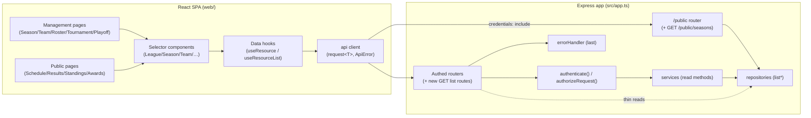
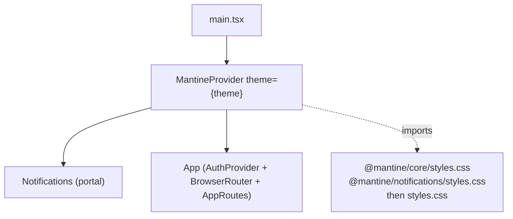
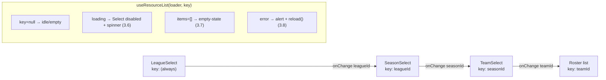

# Design Document

## Overview

This feature closes the management-UI gap described in the requirements. It is **additive**: it composes onto the existing layered backend (Express 5 + TypeScript, NodeNext/ESM, routes → services → repositories → domain) and the existing React 18 + Vite SPA without re-architecting either. Concretely it delivers three things.

1. **Authenticated list-read endpoints** (Requirements 1, 2) and **one unauthenticated public Seasons endpoint** (Requirement 7). Every read the SPA needs to populate a selector or a list view. The repositories already expose the reads (`leagueRepository.list`, `seasonRepository.listByLeague`, `teamRepository.listBySeason`, `tournamentRepository.listBySeason`, `playoffRoundRepository.listBySeason`, `seriesRepository.listByRound`), so the gap for Leagues/Seasons/Teams/Tournaments/Playoffs is only at the route layer — plus the small amount of business rule the reads carry (existence guards). The two reads the Roster view needs — the master-Player list (`GET /players`, `playerService.listPlayers`) and a Team's Roster (`GET /teams/:teamId/roster`, `playerService.getTeamRoster`) — were **already delivered by the `player-master-data` spec** and are consumed as-is here, including the Team_Manager team-scoping that the roster route and service already enforce. The new endpoints are added to the existing routers and mounted exactly where the current routers mount in `src/app.ts`.

2. **A Mantine-based management UI** (Requirement 10) that replaces free-text UUID entry with cascading, name-labeled selectors (Requirement 3), adds a Season management view (Requirement 4), makes Team (Requirement 5), Roster (Requirement 6), Tournament (Requirement 8), and Playoff (Requirement 9) views load from the API so they survive a refresh, and swaps `window.prompt`/`confirm`/`alert` for Mantine modals, forms, and notifications.

3. **A name-based Season selector for the public browsing views** (Requirement 7), backed by the new public Seasons endpoint.

The design keeps the established boundaries intact: the central `errorHandler` still maps every `DomainError` to the `{ error: { category, message, details? } }` envelope; the `authenticate()` / `authorizeRequest()` middleware still guards mutations; the pure `authorize()` function remains the single authorization rule; and the SPA's typed `request<T>` client still carries the session cookie and raises `ApiError`. The frontend gains Mantine as its component library and a small set of reusable selector components and data-loading hooks, but the auth model, routing library, and API-client transport are unchanged.

### Guiding decisions

- **List endpoints are reads, so they attach `authenticate()` and a role/scope guard, but delegate the actual read to the repository.** Where a read carries a business rule (existence → 404, Team_Manager team scoping → 403), that rule lives in a thin **service read method** so routes stay thin and authorization decisions stay out of the transport layer, matching how `teamService`/`playerService` already own their rules. Where a read carries no rule beyond "authenticated + correct role" (leagues list, seasons-by-league after an existence check, teams-by-season, tournaments-by-season, playoff rounds/series), the route composes `authenticate()` + `authorizeRequest()` and calls the repository directly inside a `withTransaction` snapshot — the same pattern `public.ts` already uses for its reads.
- **The roster read already exists and already carries per-resource authorization** (Requirement 2.4–2.6). The `player-master-data` spec shipped `GET /teams/:teamId/roster` on the assignments router (mounted at `app.use('/teams', createAssignmentsRouter())`), guarded by `authenticate()` + `authorizeRequest('update', teamResource)` where `teamResource` resolves `{ kind: 'team', teamId }` from the path, so an Administrator may read any Team's Roster and a Team_Manager only a managed Team's — satisfying 2.4–2.6 by construction. This feature adds **no** roster read endpoint and **no** `playerService.listRoster`; the SPA simply calls the existing route, which returns `RosterEntry[]` (`{ playerId, name, jerseyNumber }`) via `playerService.getTeamRoster(teamId, ex)`.
- **The SPA never sends a raw identifier the user typed.** Selectors present `{ value: id, label: name }` options and resolve a chosen option back to its id internally (Requirement 3.5, 11.5). This name↔id resolution is the one genuinely input-varying pure transformation in the feature and is covered by a correctness property.

## Architecture

### System context (unchanged shape, new routes + new UI)



### Route map added to `src/app.ts`

No new top-level `app.use(...)` mounts are required except optionally the public-seasons route, which is registered by the existing `registerPublicRoutes(app, db)` call. New authenticated GET routes are added **inside existing routers** so the existing mount points and prefixes are reused:

| Concern | Router file | Mount in `app.ts` | New route(s) |
| --- | --- | --- | --- |
| Leagues list | `src/api/routes/leagues.ts` (**new router**) | `app.use('/leagues', createLeaguesRouter())` (**new line**) | `GET /leagues` |
| Seasons by league | `src/api/routes/leagues.ts` (**new router**) | same mount | `GET /leagues/:leagueId/seasons` |
| Teams by season | `src/api/routes/seasons.ts` (existing) | `app.use('/seasons', createSeasonsRouter())` | `GET /seasons/:seasonId/teams` |
| Tournaments by season | `src/api/routes/seasons.ts` (existing) | same | `GET /seasons/:seasonId/tournaments` |
| Playoff rounds by season | `src/api/routes/seasons.ts` (existing) | same | `GET /seasons/:seasonId/playoff-rounds` |
| Series by round | `src/api/routes/seasons.ts` `createSeriesRouter` (existing) | `app.use('/playoff-rounds', createSeriesRouter())` | `GET /playoff-rounds/:roundId/series` |
| Master Players list | `src/api/routes/players.ts` (**already implemented** by `player-master-data`) | `app.use('/players', createPlayersRouter())` | `GET /players` — **no new work** |
| Team Roster | `src/api/routes/assignments.ts` (**already implemented** by `player-master-data`) | `app.use('/teams', createAssignmentsRouter())` | `GET /teams/:teamId/roster` — **no new work** |
| Public seasons | `src/api/routes/public.ts` (existing) | `registerPublicRoutes(app, db)` | `GET /public/seasons` |

**Decision — leagues get their own router.** There is no leagues router today, and Requirement 1.8 requires the authenticated Leagues/Seasons enumeration to be distinct from the public Seasons enumeration. A dedicated `createLeaguesRouter()` mounted at `/leagues` provides `GET /leagues` and `GET /leagues/:leagueId/seasons`; the public enumeration stays at `GET /public/seasons`. The two paths are governed separately (one behind `authenticate()`, one not), satisfying 1.8 by construction.

**Decision — reuse the implemented player/roster reads (no new player endpoints).** The earlier draft of this design proposed a `GET /players?teamId=…` roster read backed by a new `playerService.listRoster`. That was **superseded** by the `player-master-data` spec, which split the Player model into a master Player (`{ id, name }`) and a Roster_Assignment (`{ id, playerId, teamId, jerseyNumber }`) and shipped the reads this UI needs:

- `GET /players` → `Player[]` (`{ id, name }`) via `playerService.listPlayers(user, ex)` — Administrator-scoped — for the master-Player selector (Req 2.3, 3.9).
- `GET /teams/:teamId/roster` → `RosterEntry[]` (`{ playerId, name, jerseyNumber }`) via `playerService.getTeamRoster(teamId, ex)` — team-scoped authorization — for the Roster list (Req 2.4–2.6, 6.1).

This spec therefore defines **no** players/roster endpoint and **no** `playerService.listRoster`; those references in the earlier draft are retired. The SPA calls the existing routes directly. The write side of the Roster view also uses the already-shipped assignment routes: `POST /teams/:teamId/assignments`, `PATCH /teams/:teamId/assignments/:playerId`, `DELETE /teams/:teamId/assignments/:playerId`, plus `POST /players` for the "New player" affordance.

**Ordering note.** The public-seasons route lives on the `/public` router, which `app.ts` registers *before* the auth-guarded routers — so it stays unauthenticated. All new authenticated routes attach `authenticate()` (and, where role-gated, `authorizeRequest('read', …)`) exactly like the existing mutating routes on the same routers.

### Authorization for reads

The pure `authorize()` function today governs `'create' | 'update' | 'delete'`. Reads need a role/scope decision too. Two options were considered:

- **A. Extend `Action` with `'read'`.** Changes a widely-used domain signature and the existing `authorize()` property test.
- **B. Keep `authorize()` as-is; gate list reads with the existing actions.** `authorizeRequest('read', …)` would require adding `'read'` to the `Action` type anyway.

**Chosen: a minimal, additive read guard.** Rather than change the pure function's `Action` union, list-read authorization is expressed as small, purpose-named guards that reuse `authorize()` semantics:

- **Admin-only list reads** (leagues, seasons-by-league, teams-by-season, tournaments-by-season, playoff rounds/series): guarded by `authorizeRequest('update', adminResource)` semantics is *not* reused (that would read oddly). Instead a dedicated `authorizeRoleRequest(allowedRoles)` middleware is added to `auth.ts` that checks `req.auth.user.role ∈ allowedRoles` and throws `AuthorizationError` otherwise, and `AuthenticationError` when `req.auth` is absent. Admin-only reads use `authorizeRoleRequest(['Administrator'])`. This keeps the pure `authorize()` function untouched (no new `Action`, no changed property test) while expressing the read rule declaratively. Requirement 1.6/1.7/2.8 (401 for anonymous, 403 for Viewer) fall out directly.
- **Team-scoped roster read** (`GET /teams/:teamId/roster`): **already implemented** by `player-master-data`. The route guards with `authenticate()` + `authorizeRequest('update', req => ({ kind: 'team', teamId }))`, so an Administrator may read any Team's Roster and a Team_Manager only a managed Team's. This feature adds nothing here; it reuses the shipped behavior for Req 2.4–2.6.

> Rationale: `authorize()`'s own documentation states it "treats every governed action (create/update/delete) uniformly, so the decision is driven by role and team scope." The already-shipped roster route reuses `'update'` for its read guard on this basis, so this feature introduces **zero** change to the pure function or its property test, honoring Requirement 11.4 (no new failures) and 11.3 (backend authorization is the source of truth).

### Empty vs error semantics (shared rule for all list reads)

- **Unknown parent entity** (league/season/team that does not exist) → `NotFoundError` (404), no collection (Req 1.3, 2.6). Enforced by an existence guard (`*.findById` → null throws `NotFoundError`) before the list read, matching `public.ts`'s `requireSeason`.
- **Existing parent with no children** (league with no seasons, season with no teams, empty roster/tournaments) → `200` with `[]`, never an error (Req 1.4, 1.5, 2.7, 7.5). A repository `list*` that returns `[]` is passed straight through.

## Components and Interfaces

### Backend

#### `createLeaguesRouter()` — `src/api/routes/leagues.ts` (new)

```ts
export function createLeaguesRouter(): Router;
```

- `GET /leagues` — `authenticate()` + `authorizeRoleRequest(['Administrator'])`; returns `LeagueSummary[]` from `leagueRepository.list(db)` mapped to `{ id, name }`. Empty list → `[]` (Req 1.1, 1.5).
- `GET /leagues/:leagueId/seasons` — same guards; `withTransaction`: guard existence via `leagueRepository.findById` (→ 404 if null, Req 1.3), then `seasonRepository.listByLeague(leagueId, tx)` mapped to `SeasonSummary` (`{ id, name, startDate, endDate, closed }`, dates as ISO strings). Empty → `[]` (Req 1.2, 1.4).

#### `createSeasonsRouter()` — additions to `src/api/routes/seasons.ts`

New reads added alongside the existing POST routes, guarded by `authenticate()` + `authorizeRoleRequest(['Administrator'])`, each wrapped in `withTransaction` for a consistent snapshot and preceded by a `seasonRepository.findById` existence guard:

- `GET /seasons/:seasonId/teams` → `TeamSummary[]` (`{ id, name }`) from `teamRepository.listBySeason` (Req 2.1, 2.6, 2.7).
- `GET /seasons/:seasonId/tournaments` → `TournamentSummary[]` (`{ id, format, roundRobinKind? }`) from `tournamentRepository.listBySeason` (Req 2.3, 2.7).
- `GET /seasons/:seasonId/playoff-rounds` → `PlayoffRoundSummary[]` (`{ id, type }`) from `playoffRoundRepository.listBySeason` (Req 9 selectors).

#### `createSeriesRouter()` — addition to `src/api/routes/seasons.ts`

- `GET /playoff-rounds/:roundId/series` → `SeriesSummary[]` (`{ id, teamAId, teamBId, bestOf }`) from `seriesRepository.listByRound`; `authenticate()` + `authorizeRoleRequest(['Administrator'])` (Req 9 series selector).

#### Master-Player and roster/assignment routes — **already implemented** (`player-master-data`)

No backend work is added for players or rosters. The `player-master-data` spec shipped these routes, which this UI consumes verbatim:

- **Master Players** — `src/api/routes/players.ts`, mounted `app.use('/players', createPlayersRouter())`; Administrator-scoped (`authorizeRequest(action, () => ({ kind: 'admin' }))`), the service re-checking via `assertAdmin`:
  - `GET /players` → `Player[]` (`{ id, name }`) via `playerService.listPlayers(user, db)` — populates the Player_Selector (Req 2.3, 3.9); empty → `[]`.
  - `POST /players` `{ name }` → `201` `Player` via `playerService.createPlayer` — backs the "New player" affordance (Req 6.5).
  - (`GET /players/:playerId`, `PATCH /players/:playerId`, `DELETE /players/:playerId`, `GET /players/:playerId/history` also exist but are not used by this UI.)
- **Roster + assignments** — `src/api/routes/assignments.ts`, mounted `app.use('/teams', createAssignmentsRouter())`; team-scoped (`authorizeRequest(action, req => ({ kind: 'team', teamId }))`), the service re-checking via `assertTeamAuthorized`:
  - `GET /teams/:teamId/roster` → `RosterEntry[]` (`{ playerId, name, jerseyNumber }`) via `playerService.getTeamRoster(teamId, db)` — the Roster list (Req 2.4–2.6, 6.1); empty → `[]` (Req 2.8).
  - `POST /teams/:teamId/assignments` `{ playerId, jerseyNumber }` → `201` `RosterAssignment` via `playerService.assignPlayer` (Req 6.4). Jersey-range/non-integer → `ValidationError`; duplicate jersey or same-Season second assignment → `ConflictError`; unknown player/team → `NotFoundError`.
  - `PATCH /teams/:teamId/assignments/:playerId` `{ jerseyNumber }` → `200` `RosterAssignment` via `playerService.updateAssignmentJersey` (Req 6.8).
  - `DELETE /teams/:teamId/assignments/:playerId` → `204` via `playerService.unassignPlayer` (Req 6.9).

Because these exist, the only `playerService` surface this UI touches is read via `listPlayers`/`getTeamRoster` and mutate via `createPlayer`/`assignPlayer`/`updateAssignmentJersey`/`unassignPlayer`; **no new service method is introduced** by this spec.

#### `createPublicRouter(db)` — addition to `src/api/routes/public.ts`

- `GET /public/seasons` — unauthenticated (like the other public routes). Returns a **field-limited** projection `PublicSeasonSummary` = `{ id, name, closed }` for the seasons available for public browsing. It **must not** expose management-only fields (`leagueId`, `startDate`, `endDate`, `finalStandingsSnapshot`) (Req 7.4, 7.6). Empty → `{ seasons: [], message }` never an error (Req 7.5), matching the existing public payload style.

  ```ts
  export interface PublicSeasonSummary { id: string; name: string; closed: boolean; }
  export interface PublicSeasonsPayload { seasons: PublicSeasonSummary[]; message?: string; }
  ```

  **Public-browsing source.** "Available for public browsing" is defined as *all seasons* for this spec (the SPA already treats any season's schedule/results/standings as public). The endpoint reads seasons across leagues by iterating `leagueRepository.list` → `seasonRepository.listByLeague` inside one `withTransaction` and projecting each to `PublicSeasonSummary`. A dedicated projection function `toPublicSeason(season): PublicSeasonSummary` performs the field-limiting so the leakage guarantee is unit- and property-testable in isolation.

#### `authorizeRoleRequest(roles)` — addition to `src/api/middleware/auth.ts`

```ts
export function authorizeRoleRequest(allowed: readonly Role[]): RequestHandler;
```

Mirrors `authorizeRequest` but decides purely on `req.auth.user.role`: absent `req.auth` → `AuthenticationError` (401); role not in `allowed` (including `null`) → `AuthorizationError` (403); otherwise `next()`. This is the read-side analogue of `authorizeRequest` and leaves the pure `authorize()` untouched.

### Frontend

#### Mantine integration (Requirement 10)

**Packages** (added to `web/package.json` dependencies): `@mantine/core`, `@mantine/hooks`, `@mantine/form`, `@mantine/notifications`, and the PostCSS toolchain Mantine needs for its styles: `postcss`, `postcss-preset-mantine`, `postcss-simple-vars` (devDependencies).

**PostCSS config** — new `web/postcss.config.cjs`:

```js
module.exports = {
  plugins: {
    'postcss-preset-mantine': {},
    'postcss-simple-vars': {
      variables: {
        'mantine-breakpoint-xs': '36em',
        'mantine-breakpoint-sm': '48em',
        'mantine-breakpoint-md': '62em',
        'mantine-breakpoint-lg': '75em',
        'mantine-breakpoint-xl': '88em',
      },
    },
  },
};
```

**Provider wiring** — `web/src/main.tsx` imports Mantine's CSS once and wraps the app in `MantineProvider` (with a shared `theme`) and mounts the `Notifications` portal. Existing `styles.css` is imported *after* Mantine's CSS so app-level tweaks (skip link, layout) still apply; the two coexist because Mantine is class-scoped and `styles.css` targets app-specific selectors.



`App.tsx` keeps `AuthProvider` + `BrowserRouter` + `AppRoutes` unchanged; the Mantine providers sit *above* it in `main.tsx` so both production and tests can wrap consistently. A test helper `renderWithProviders` wraps components in `MantineProvider` + `MemoryRouter` (+ `AuthProvider` when needed).

- `theme` (`web/src/theme.ts`): a single `createTheme({...})` applying primary color, font, default radius — satisfying Req 10.1 (single theme across views).

#### API client additions

New wire types in `web/src/api/types.ts` (mirroring the backend summaries) and new endpoint groups in `web/src/api/endpoints.ts`, re-exported from `web/src/api/index.ts`:

```ts
// endpoints.ts
export const leaguesApi = {
  list(signal?): Promise<LeagueSummary[]>,                       // GET /leagues
  seasons(leagueId, signal?): Promise<SeasonSummary[]>,          // GET /leagues/:id/seasons
};
export const seasonsApi = {
  create(input: CreateSeasonRequest): Promise<SeasonSummary>,    // POST /seasons
  close(seasonId): Promise<SeasonSummary>,                       // POST /seasons/:id/close
  teams(seasonId, signal?): Promise<TeamSummary[]>,              // GET /seasons/:id/teams
  tournaments(seasonId, signal?): Promise<TournamentSummary[]>,  // GET /seasons/:id/tournaments
  createTournament(seasonId, input): Promise<TournamentSummary>, // POST /seasons/:id/tournaments
  playoffRounds(seasonId, signal?): Promise<PlayoffRoundSummary[]>,
  createPlayoffRound(seasonId, input): Promise<PlayoffRoundSummary>,
  createPlayoffGame(seasonId, input): Promise<GameSummary>,
};
export const playoffApi = {
  series(roundId, signal?): Promise<SeriesSummary[]>,            // GET /playoff-rounds/:id/series
  createSeries(roundId, input): Promise<SeriesSummary>,          // POST /playoff-rounds/:id/series
};
// Master Players — reads/creates against the already-implemented /players routes.
// NOTE: the current web/src/api/endpoints.ts `playersApi` (add/update/remove on
// /players with an AddPlayerRequest carrying teamId+jerseyNumber) targets the
// OLD team-scoped player model and is stale. It is replaced by the master-player
// shape below; the roster write side moves to `assignmentsApi`.
export const playersApi = {
  listMasters(signal?): Promise<Player[]>,                       // GET /players  (already implemented)
  createMaster(input: CreatePlayerRequest): Promise<Player>,     // POST /players (already implemented)
};
// Team-scoped roster + assignments — all against already-implemented routes.
export const assignmentsApi = {
  roster(teamId, signal?): Promise<RosterEntry[]>,               // GET    /teams/:teamId/roster
  assign(teamId, input: AssignPlayerRequest): Promise<RosterAssignment>,       // POST   /teams/:teamId/assignments
  updateJersey(teamId, playerId, input: UpdateJerseyRequest): Promise<RosterAssignment>, // PATCH  /teams/:teamId/assignments/:playerId
  unassign(teamId, playerId): Promise<void>,                     // DELETE /teams/:teamId/assignments/:playerId
};
export const teamsApi = { /* existing create/update/remove */ };
export const publicApi = { /* existing + */
  seasons(signal?): Promise<PublicSeasonsPayload>,               // GET /public/seasons
};
```

Each list function forwards its `AbortSignal` to `request<T>`, so the existing abort-on-cleanup behavior of `useAsync` carries over.

#### Data-loading approach for cascading selectors

**Decision: a light, purpose-built resource-cache hook layered over the existing `useAsync` pattern — not a new dependency like React Query.** Rationale: the SPA already ships a small `useAsync(loader, key)` that handles loading/data/error and aborts stale requests; adopting it broadly keeps bundle size and cognitive load low and satisfies Req 3.6–3.8 directly. Cascading selectors need two small additions on top:

1. **`useResourceList<T>(loader, key)`** — a thin wrapper over `useAsync` that also exposes a `reload()` function (Req 3.8 retry) and normalizes `null`/error into `{ items, loading, error, reload }`. When `key` is `null` the loader is skipped (parent not yet chosen), which is exactly the cascading gate: the Season loader keys off the selected `leagueId`, the Team loader off the selected `seasonId`, so selecting a parent triggers the child load and clearing a parent resets the child (Req 3.3, 3.4).
2. **A tiny in-memory cache (`resourceCache`)** keyed by request path, wrapping the loader so re-opening a view or re-selecting a previously chosen parent is instant and does not refetch. The cache is invalidated for the relevant key after a successful create/close/delete/rename so list views reflect mutations (Req 4.2, 5.3, etc.). This avoids a heavyweight query library while still surviving refresh (the cache is per-page-load; a refresh refetches from the API, which is the source of truth — Req 5.2, 6.2).



#### Reusable selector components (Requirement 3, 10.2)

All live in `web/src/components/selectors/` and build on Mantine `Select`. Each renders a labeled, keyboard-navigable combobox, presents options by **name**, and calls `onChange(id)` with the resolved **identifier** — never exposing a text id field.

- **`EntitySelect<T>`** — the generic base. Props: `label`, `items: T[]`, `getId(t)=>string`, `getLabel(t)=>string`, `value: string | null`, `onChange(id: string | null)`, `loading`, `error`, `onRetry`, `emptyMessage`, `id`/`aria-*`. It builds Mantine `SelectData` (`{ value, label }[]`) via a **pure `buildOptions` + `resolveById` pair** (see Correctness Properties); disables itself and shows a spinner while `loading` (Req 3.6); renders an accessible empty state (`role="status"`) when `items` is empty and no free-text fallback (Req 3.7); and renders an `Alert` (`role="alert"`) with a Retry button wired to `onRetry` when `error` (Req 3.8).
- **`LeagueSelect`**, **`SeasonSelect`**, **`TeamSelect`** — thin wrappers over `EntitySelect` bound to `leaguesApi`/`seasonsApi`/… via `useResourceList`, with the cascading keys described above.
- **`PlayerSelect`** — a wrapper over `EntitySelect` bound to `playersApi.listMasters()` via `useResourceList` (loaded for the Roster view, not cascaded off a parent). It lists **master Players by name**; because master-Player names are not unique (`player-master-data` Req 1.3) the option `value` is always the Player `id`, so duplicate names remain unambiguous — exactly the invariant Property 1 covers. Used in the Roster view to pick which existing person to assign (Req 3.9, 6.4).
- **Generic value selects** (no API): **`PlayoffRoundTypeSelect`** (Quarterfinals/Semifinals/Finals), **`TournamentFormatSelect`** (single-/double-elimination, round-robin), **`RoundRobinKindSelect`** (single/double), **`BestOfSelect`** (1/3/5/7). These are `EntitySelect` instances over static option arrays, so the UI can only offer valid values (making Req 8.4, 9.3, 9.5 primarily server-surfacing rather than client-reachable).

**Name → identifier resolution.** `EntitySelect` never surfaces the label as the outgoing value. `buildOptions(items)` maps each entity to `{ value: getId(item), label: getLabel(item) }`; Mantine returns the selected `value` (the id) on change; `resolveById(items, id)` recovers the full entity when the page needs more than the id. Duplicate names are allowed because the option `value` is always the unique id, not the label. This resolution is the subject of **Correctness Property 1**.

#### Page designs

Routing/nav changes in `App.tsx` + `Layout.tsx`: add `manage/seasons`, `manage/tournaments`, `manage/playoffs` routes (Admin-gated via the existing `ProtectedRoute requireAdmin`), keep `manage/teams` (Admin) and `manage/players` (auth). The `Layout` nav gains "Seasons", "Tournaments", "Playoffs" links under the authenticated/admin section; the public nav is unchanged except each public page swaps its `SeasonPicker` text input for a `SeasonSelect`.

- **Season management (`SeasonsPage`, Req 4)** — `LeagueSelect` → Mantine `Table` of that league's seasons (name/start/end/closed) from `seasonsApi`-via-`leaguesApi.seasons`. A "Create Season" `@mantine/form` (name, start `DateInput`, end `DateInput`) with inline validation (name 1–100; end strictly after start — Req 4.3). Each open season row has a "Close" action opening a Mantine confirm modal (Req 4.5); closed rows show the close action disabled (Req 4.6). Success/failure via notifications (Req 4.2, 4.8); empty league → empty state (Req 4.7).
- **Team management (`TeamsPage` rewrite, Req 5)** — `LeagueSelect` → `SeasonSelect` → Mantine `Table` of `seasonsApi.teams(seasonId)`; list is API-backed so it survives refresh (Req 5.1, 5.2). Create form (name 1–100); rename via a Mantine modal form (replacing `window.prompt`); delete via a confirm modal (replacing `window.confirm`). After each mutation the list key is cache-invalidated and refetched (Req 5.3, 5.5–5.7). Empty → empty state (Req 5.8).
- **Roster management (`PlayersPage` rewrite, Req 6)** — `SeasonSelect` → `TeamSelect` → roster `Table` from `assignmentsApi.roster(teamId)` showing each `RosterEntry` (`name`, `jerseyNumber`) (Req 6.1, 6.2). The roster model is now **master Player + assignment**, so the view assigns an *existing* person rather than creating a player on the team:
  - **Assign form** — a `PlayerSelect` (master Players from `playersApi.listMasters()`) + a jersey `NumberInput` (0–99 integer). Submit calls `assignmentsApi.assign(teamId, { playerId, jerseyNumber })` (Req 6.4).
  - **New player affordance** — a "New player" action opens a Mantine modal collecting a name (1–100). It calls `playersApi.createMaster({ name })` then immediately `assignmentsApi.assign(teamId, { playerId: created.id, jerseyNumber })`, so an Administrator can register and assign a new person without leaving the view (Req 6.5). This action is shown only when the principal may create master Players (Administrator); for a Team_Manager it is hidden/disabled since `POST /players` is Administrator-scoped.
  - **Change jersey** — editing a roster row opens a jersey form calling `assignmentsApi.updateJersey(teamId, playerId, { jerseyNumber })` (Req 6.8).
  - **Unassign** — a confirm modal calling `assignmentsApi.unassign(teamId, playerId)`; the master Player is retained (Req 6.9).
  - Inline validation mirrors the server bounds (jersey 0–99 integer; name 1–100 for the new-player modal) (Req 6.6). Server `ConflictError`s — duplicate jersey, or the Player already assigned to a Team in that Season — surface inline on the assign form (Req 6.6, 6.7).
  - **Authorization presentation:** when the signed-in principal is a Team_Manager and `!canManageTeam(selectedTeamId)`, the assign/change-jersey/unassign/new-player controls render disabled and an accessible notice explains the restriction (Req 6.3, 11.3) — the UI never sends a request the backend would 403. Empty roster → empty state (Req 6.10).
- **Tournament management (`TournamentsPage`, Req 8)** — `SeasonSelect` → `Table` of `seasonsApi.tournaments(seasonId)` (format + round-robin kind). Create form with `TournamentFormatSelect`; when `round-robin` is chosen the `RoundRobinKindSelect` becomes required and is validated before submit (Req 8.3). Notifications + empty state (Req 8.2, 8.5, 8.6).
- **Playoff management (`PlayoffsPage`, Req 9)** — `SeasonSelect` gates three sub-forms: create Round (`PlayoffRoundTypeSelect`); create Series (`PlayoffRound`-select from `seasonsApi.playoffRounds`, two `TeamSelect`s, `BestOfSelect`); create Playoff Game (round select, two `TeamSelect`s, `DateInput`, optional Series select from `playoffApi.series(roundId)`). Client validation rejects identical teams before submit (Req 9.7); closed-season and other server errors surface as notifications (Req 9.8, 9.10). All choices are Selectors — no id entry (Req 9.9).
- **Public browsing (`SchedulePage`/`ResultsPage`/`StandingsPage`/`AwardsPage`, Req 7)** — each replaces `SeasonPicker` with a `PublicSeasonSelect` backed by `publicApi.seasons()`, writing the resolved id to the `season` query param (deep-link preserved). Empty public seasons → accessible empty state, no free-text fallback (Req 7.3).

#### Replacing `window.prompt`/`confirm`/`alert` (Requirement 10.6)

- `window.prompt` (rename team, edit player) → Mantine modal containing a `@mantine/form`.
- `window.confirm` (delete team, close season, remove player) → Mantine confirm modal (`modals.openConfirmModal` or a controlled `Modal`).
- `window.alert` / inline `ErrorMessage` for operation outcomes → `@mantine/notifications` (`notifications.show({ color, message })`), with success and failure variants (Req 10.5, 11.2). Inline *field* errors stay inline via `@mantine/form` `errors` (Req 10.4). A grep for `window.prompt|window.confirm|window.alert` in `web/src/pages/manage` and `web/src/components` must return nothing after the rework (Req 10.6 smoke check).

#### Inline form validation (Requirement 10.4) mirroring backend bounds

`@mantine/form` validators mirror the server bounds so users get immediate feedback while the server remains the source of truth:

| Field | Client rule | Server rule mirrored |
| --- | --- | --- |
| Season name | trimmed length 1–100 | `SeasonTournamentService` name bound |
| Season dates | end strictly after start | Season end > start |
| Team name | trimmed length 1–100 | `teamService.normalizeName` |
| Player name (new-player modal) | trimmed length 1–100 | `playerService.validateName` |
| Jersey number (assign / change-jersey) | integer 0–99 | `playerService.validateJerseyNumber` |
| Best-of-N | ∈ {1,3,5,7} (Select) | `BestOfNValues` |
| Tournament format | ∈ {single-/double-elimination, round-robin} (Select) | `TournamentFormats` |
| Round-robin kind | required when format = round-robin | service rule |
| Playoff round type | ∈ {Quarterfinals, Semifinals, Finals} (Select) | `PlayoffRoundTypes` |
| Two teams | must differ | domain "teams distinct" |

Server-only rules (case-insensitive team-name uniqueness, jersey uniqueness within a Team, one-Roster_Assignment-per-Player-per-Season, completed-game delete gating, closed-season gating) are **not** duplicated client-side; their `ApiError` messages surface as notifications/field errors.

## Data Models

### Backend response payloads (new)

```ts
// src/api/routes/leagues.ts
export interface LeagueSummary { id: string; name: string; }
export interface SeasonSummary {
  id: string; name: string;
  startDate: string;  // ISO date
  endDate: string;    // ISO date
  closed: boolean;
}

// src/api/routes/seasons.ts (reads)
export interface TeamSummary { id: string; name: string; }
export interface TournamentSummary {
  id: string;
  format: 'single-elimination' | 'double-elimination' | 'round-robin';
  roundRobinKind?: 'single' | 'double';
}
export interface PlayoffRoundSummary { id: string; type: 'Quarterfinals' | 'Semifinals' | 'Finals'; }
export interface SeriesSummary {
  id: string; teamAId: string; teamBId: string; bestOf: 1 | 3 | 5 | 7;
}

// Master Players / Roster — NOT defined by this spec; already shipped by
// `player-master-data` in src/domain/types.ts and surfaced by its routes:
//   Player           { id: string; name: string }                       // GET /players
//   RosterEntry      { playerId: string; name: string; jerseyNumber: number } // GET /teams/:teamId/roster
//   RosterAssignment { id: string; playerId: string; teamId: string; jerseyNumber: number } // POST/PATCH assignment responses
// This spec references these shapes; it does not redefine them.

// src/api/routes/public.ts (read)
export interface PublicSeasonSummary { id: string; name: string; closed: boolean; }
export interface PublicSeasonsPayload { seasons: PublicSeasonSummary[]; message?: string; }
```

### Backend request payloads (new UI-driven creates that lacked a typed wire shape)

```ts
export interface CreateSeasonRequest { leagueId: string; name: string; startDate: string; endDate: string; }
export interface CreateTournamentRequest { format: TournamentFormat; roundRobinKind?: 'single' | 'double'; }
export interface CreatePlayoffRoundRequest { type: PlayoffRoundType; }
export interface CreateSeriesRequest { teamAId: string; teamBId: string; bestOf: 1 | 3 | 5 | 7; }
export interface CreatePlayoffGameRequest {
  homeTeamId: string; awayTeamId: string; date: string;
  startTime?: string | null; durationMinutes?: number | null; venue?: string | null;
  playoffRoundId: string; seriesId?: string | null;
}
```

These map onto the existing service commands (`CreateSeasonCommand`, `CreateTournamentCommand`, `CreateSeriesCommand`, `CreatePlayoffGameCommand`) and the existing POST routes; no service signature changes.

### Frontend wire types

`web/src/api/types.ts` mirrors every summary/request above (dates as ISO strings), following the existing convention that the web bundle duplicates wire types rather than importing Node-only modules. For the Roster view it also mirrors the master-player/assignment shapes the `player-master-data` routes produce, **replacing** the stale team-scoped player types currently in `types.ts` (`Player` with `teamId`+`jerseyNumber`, `AddPlayerRequest`, `UpdatePlayerRequest`):

```ts
// web/src/api/types.ts (replaces the old team-scoped Player types)
export interface Player { id: string; name: string; }                       // master Player (GET /players)
export interface RosterEntry { playerId: string; name: string; jerseyNumber: number; } // GET /teams/:teamId/roster
export interface RosterAssignment { id: string; playerId: string; teamId: string; jerseyNumber: number; }
export interface CreatePlayerRequest { name: string; }                       // POST /players
export interface AssignPlayerRequest { playerId: string; jerseyNumber: number; } // POST /teams/:teamId/assignments
export interface UpdateJerseyRequest { jerseyNumber: number; }               // PATCH /teams/:teamId/assignments/:playerId
```

Retiring the old `Player { teamId, jerseyNumber }` / `AddPlayerRequest` / `UpdatePlayerRequest` types and the stale `playersApi.add/update/remove` is a frontend-only reconciliation; it does not touch backend code, which already serves the new shapes.

### Selector option model (frontend, internal)

```ts
export interface SelectOption { value: string; label: string; }  // value is ALWAYS the entity id
// pure helpers (subject of Correctness Property 1)
function buildOptions<T>(items: T[], getId: (t: T) => string, getLabel: (t: T) => string): SelectOption[];
function resolveById<T>(items: T[], getId: (t: T) => string, id: string | null): T | undefined;
```

## Correctness Properties

*A property is a characteristic or behavior that should hold true across all valid executions of a system — essentially, a formal statement about what the system should do. Properties serve as the bridge between human-readable specifications and machine-verifiable correctness guarantees.*

Most of this feature is thin authenticated CRUD reads (verified by DB-less route/integration tests) and Mantine UI wiring (verified by component tests) — neither is a good fit for property-based testing, and the role/team authorization rule is already covered by the pure `authorize()` property test in the base spec (this feature adds no new authorization logic, only a read guard that reuses it). Two behaviors in this feature *are* genuinely input-varying pure transformations where a wrong mapping would reintroduce exactly the class of defect this spec exists to fix (sending the wrong identifier) or leak restricted data, so they are specified as properties.

### Property 1: Selector name/identifier resolution round trip

*For all* lists of entities (each carrying a unique identifier and a human-readable name, with names allowed to collide, be empty, or contain arbitrary Unicode) and *for any* single entity chosen from that list, building the selector's options from the list and then resolving the chosen option's emitted value back to an entity SHALL yield exactly the chosen entity's identifier — never another entity's identifier — and the option presented for the chosen entity SHALL carry that entity's name as its label.

**Validates: Requirements 3.5, 7.2**

### Property 2: Public Season projection exposes only browsing-safe fields

*For all* Season entities (with or without a final standings snapshot, and regardless of their league, start date, or end date), the public Season projection SHALL contain exactly the identifier, name, and closed flag with values equal to the source Season, and SHALL NOT contain the league identifier, start date, end date, final standings snapshot, or any other management-only field.

**Validates: Requirements 7.6**

## Error Handling

The backend error taxonomy and central `errorHandler` are unchanged; new endpoints only *throw* the existing `DomainError` subclasses, which map to the standard envelope and status:

| Situation | Error thrown (backend) | HTTP | Envelope `category` | Requirements |
| --- | --- | --- | --- | --- |
| Anonymous hits an authenticated list read | `AuthenticationError` | 401 | `AuthenticationError` | 1.6, 2.9 |
| Viewer hits an admin-only list read | `AuthorizationError` | 403 | `AuthorizationError` | 1.7 |
| Team_Manager reads/mutates an unassigned team's roster | `AuthorizationError` | 403 | `AuthorizationError` | 2.6, 6.3 |
| Unknown league/season/team on a list read | `NotFoundError` | 404 | `NotFoundError` | 1.3, 2.7 |
| Invalid create input (bounds/format/best-of/dates); invalid jersey (range/non-integer) | `ValidationError` | 400 | `ValidationError` | 4.3–4.4, 6.6, 8.4, 9.3, 9.5, 9.7 |
| Duplicate season/team name; duplicate jersey on a Team's Roster | `ConflictError` | 409 | `ConflictError` | 4.4, 5.4, 6.6 |
| Player already assigned to a Team in the same Season | `ConflictError` | 409 | `ConflictError` | 6.7 |
| Delete team with completed games; create in closed season | `ConstraintError` | 409 | `ConstraintError` | 5.7, 9.8 |

**Empty is not an error.** All list reads return `200` with an empty array (or empty payload with a `message`) when the parent exists but has no children (Req 1.4, 1.5, 2.8, 7.5). The already-implemented `GET /teams/:teamId/roster` and `GET /players` follow the same rule (empty → `[]`).

**Frontend flow.** `request<T>` continues to raise `ApiError` carrying `category`, `message`, `status`, `details`. Pages map it as follows:

- **Field-level** — when `category === 'ValidationError'` (or `ConflictError`) and `details.field` is present, set that field's error via `@mantine/form` `setFieldError` so it renders inline next to the input (Req 4.4, 5.4, 6.6, 6.7, 10.4).
- **Operation-level** — otherwise show an error `notification` with the `ApiError.message` verbatim (never a fabricated message), leaving the displayed list unchanged (Req 4.8, 5.7, 8.6, 9.10, 11.2).
- **List-load failure** — surfaced by the selector/list as an accessible `Alert` (`role="alert"`) plus a Retry that re-invokes the loader (Req 3.8).
- **Unauthenticated (401)** — `ApiError.isUnauthenticated` is honored as today (the app treats it as "signed out"); management routes are already behind `ProtectedRoute`, so this is an edge (e.g. session expiry mid-session) that surfaces a notification and lets `AuthContext` fall back to anonymous.

## Testing Strategy

Property-based testing is applied only to the two pure transformations above; everything else uses example-based unit/route tests, integration-style route tests, and Testing Library component tests. This mirrors the existing suite (`publicAwards.test.ts` route test, `batchUploadService.test.ts` DB-less service test).

### Property tests (frontend, `fast-check` — already a dev dependency)

- **Property 1** — over generated `{ id, name }[]` (unique ids; names allowed to duplicate, be empty, or Unicode) and a random chosen entity: assert `resolveById(items, getId, buildOptions(...)[chosenIndex].value)?.id === chosen.id` and the built option's `label === getLabel(chosen)`. Min 100 iterations.
  - Tag: `Feature: management-ui, Property 1: Selector name/identifier resolution round trip`
- **Property 2** — over generated `Season` objects (with/without `finalStandingsSnapshot`, arbitrary `leagueId`/dates): assert `Object.keys(toPublicSeason(s)).sort()` equals `['closed','id','name']`, the three values equal the source, and the result contains none of `leagueId`/`startDate`/`endDate`/`finalStandingsSnapshot`. Min 100 iterations. (Runs in the backend Vitest project since `toPublicSeason` lives in `public.ts`.)
  - Tag: `Feature: management-ui, Property 2: Public Season projection exposes only browsing-safe fields`

`fast-check` is used for both; property tests are implemented with a single property-based test each (never hand-rolled iteration).

### Backend route tests (DB-less, stub repositories/`db.transaction`)

Following `publicAwards.test.ts` (mount router on an ephemeral Express server, drive with `fetch`, `vi.spyOn` the repositories) and `batchUploadService.test.ts` (`stubDb()` whose `transaction` invokes the callback with a marker tx):

- **Leagues router** — `GET /leagues`: 200 + `[{id,name}]`; empty → `[]`; anonymous → 401; Viewer → 403. `GET /leagues/:id/seasons`: projected fields; unknown league → 404; empty → `[]`. Authenticated principals injected by stubbing `authenticate()`/session as the existing auth-guarded tests do.
- **Seasons reads** — `GET /seasons/:id/teams|tournaments|playoff-rounds`: projected fields; unknown season → 404; empty → `[]`; anonymous → 401; Viewer → 403.
- **Series read** — `GET /playoff-rounds/:id/series`: projected fields; empty → `[]`; authz cases.
- **Master Players / Roster reads** — **no new backend tests**: `GET /players`, `GET /teams/:teamId/roster`, and the assignment mutations are already covered by the `player-master-data` suite (`players.test.ts`, `assignments.test.ts`, `playerService.test.ts`, including the roster-shape and team-scope authorization properties). This feature adds only the **frontend** tests for the Roster page that mock `playersApi`/`assignmentsApi` (below).
- **Public seasons** — `GET /public/seasons` (no cookie): 200 + `[{id,name,closed}]`; none → empty payload with message (not 404); assert the response objects contain **no** `startDate`/`endDate`/`leagueId`/`finalStandingsSnapshot` keys (defense-in-depth alongside Property 2).

### Frontend component tests (Testing Library, mock the API client)

Wrap in `renderWithProviders` (`MantineProvider` + `MemoryRouter` [+ `AuthProvider`]). Mock `web/src/api` functions with `vi.mock`.

- **`EntitySelect`** — renders a labeled combobox (`getByRole('combobox', { name })`); options labeled by name; keyboard-openable; disabled + spinner while `loading` (Req 3.6); empty state with no text-id field (Req 3.7); error `Alert` + Retry re-invokes loader (Req 3.8); selecting an option calls `onChange` with the entity **id** (Req 3.5). No raw-id input anywhere (Req 3.1, 11.5).
- **Cascading** — a `SeasonsPage`/`TeamsPage` test: choosing a league loads seasons; choosing a season loads teams (assert the cascade fires the right API calls and renders options).
- **A management page (e.g. `TeamsPage`)** — API-backed list renders from the mocked list endpoint and re-renders after a create (list refetch), proving refresh-independence (Req 5.1–5.3); rename/delete use Mantine modal + confirm (no `window.*`); success/failure show notifications; server `ValidationError` with `details.field` renders inline (Req 5.4).
- **Roster page (`PlayersPage`)** — mock `playersApi.listMasters`/`createMaster` and `assignmentsApi.roster/assign/updateJersey/unassign`. Assert: the roster `Table` renders from `assignmentsApi.roster` and refetches after a mutation (refresh-independence, Req 6.1, 6.2); the `PlayerSelect` lists master Players by name (duplicate names stay distinguishable because the option value is the id); assigning calls `assignmentsApi.assign(teamId, { playerId, jerseyNumber })` and shows a success notification (Req 6.4); the "New player" modal calls `createMaster` then `assign` (Req 6.5); a server `ConflictError` for a duplicate jersey or a same-Season second assignment renders inline on the assign form (Req 6.6, 6.7); change-jersey calls `updateJersey` (Req 6.8); unassign uses a confirm modal and calls `unassign` (Req 6.9); empty roster → empty state (Req 6.10).
- **Roster authorization presentation** — Team_Manager with `managedTeamIds=[T1]`: selecting T1 enables controls; selecting T2 disables the assign/change-jersey/unassign/new-player controls and shows the accessible notice (Req 6.3, 11.3). Administrator: controls always enabled; the "New player" control is shown only for an Administrator (since `POST /players` is Administrator-scoped, Req 6.5).
- **Accessibility** — every field/selector reachable by `getByLabelText`; outcome regions expose `role="alert"`/`role="status"` (Req 11.1, 11.2).

### Quality gates (Req 11.4)

`npm run typecheck`, `npm run lint`, `npm run build`, and `npm test` (backend Vitest) plus `npm test --workspace web` must all pass with no new failures. A grep check confirms no `window.prompt|confirm|alert` remain in the management views (Req 10.6). New PostCSS/Mantine config must not break the existing `vite build` or the Vitest jsdom setup (the test setup imports Mantine matchMedia shim if needed).

## Accessibility Notes (Requirement 11.1–11.2)

- **Labels** — every Mantine input/`Select` is given a `label` (or `aria-label`), which Mantine renders as a programmatically associated `<label>`; forms are reachable and operable by keyboard alone (Req 11.1). Selectors expose `role="combobox"` with full keyboard navigation from Mantine `Select` (Req 10.2).
- **Status announcements** — success/error notifications use `@mantine/notifications`, which renders into an `aria-live` region so assistive tech announces outcomes; list-load errors use `role="alert"` and empty states use `role="status"` (Req 11.2, 4.8, 8.6).
- **Confirmations** — delete/close use Mantine modals, which trap focus and are dismissible by keyboard, replacing the non-accessible native `window.confirm` (Req 10.6).
- **Authorization affordances** — controls the user cannot use are rendered `disabled` with an accompanying visible + programmatic notice, rather than hidden or allowed-then-rejected (Req 6.3, 11.3).
- **Public views** — the season selector is a labeled `Select`; the empty-state message is in a `role="status"` region and there is no free-text id fallback (Req 7.3).

## Requirements Coverage

| Requirement | Satisfied by (design sections) |
| --- | --- |
| **1. Authenticated Leagues/Seasons list reads** | `createLeaguesRouter` (`/leagues`, `/leagues/:id/seasons`); `authorizeRoleRequest(['Administrator'])`; empty-vs-error rule; **1.8** by distinct `/leagues` vs `/public/seasons` paths (Architecture → Route map, Authorization for reads) |
| **2. Authenticated Teams/Tournaments reads (new) + master-Player/Roster reads (already implemented)** | New seasons-router reads (`/seasons/:id/teams`, `/seasons/:id/tournaments`) with existence/empty rules; **already-implemented** `GET /players` (`listPlayers`, **2.3**) and `GET /teams/:teamId/roster` (`getTeamRoster`, team-scoped authz **2.4–2.6**, empty **2.8**) consumed from `player-master-data` (Architecture → Route map, Components → "already implemented") |
| **3. League/Season/Team selectors replace id entry** | `EntitySelect` + `League/Season/TeamSelect`, `useResourceList` cascade, loading/empty/error states (**3.6–3.8**), name→id resolution (**3.5**, Property 1) |
| **4. Season management UI** | `SeasonsPage` (Table + create form + close modal, empty state, notifications), date/name inline validation (Components → Page designs, Form validation) |
| **5. Team management UI (list-backed)** | `TeamsPage` rewrite (API-backed list, create/rename/delete via Mantine, refresh-independence, error/empty handling) |
| **6. Roster management UI (master-player + assignment model, scoped)** | `PlayersPage` rewrite: roster list via `assignmentsApi.roster`; assign existing master Player via `PlayerSelect` + `assignmentsApi.assign` (**6.4**); "New player" via `playersApi.createMaster` then assign (**6.5**); jersey/same-season-conflict surfacing (**6.6, 6.7**); change jersey via `assignmentsApi.updateJersey` (**6.8**); unassign via `assignmentsApi.unassign` retaining the master Player (**6.9**); Team_Manager control gating (**6.3**); empty state (**6.10**) |
| **7. Public browsing uses a Season selector** | `PublicSeasonSelect` + `GET /public/seasons` (`toPublicSeason` field-limiting, empty-not-error), Property 2 (**7.6**) |
| **8. Tournament management UI** | `TournamentsPage` (`TournamentFormatSelect`/`RoundRobinKindSelect`, conditional kind requirement **8.3**, notifications/empty state) |
| **9. Playoff Round/Series/Game UI** | `PlayoffsPage` (round/series/game sub-forms, all-Selector inputs **9.9**, distinct-teams client check **9.7**, closed-season/server error surfacing) |
| **10. Adoption of Mantine** | Mantine integration (provider/theme/Notifications/PostCSS), Selects (10.2), Tables (10.3), form validation (10.4), notifications (10.5), replacing `window.*` (10.6) |
| **11. Accessibility, authorization, quality gates** | Accessibility Notes (11.1–11.2), authorization-as-source-of-truth control gating (11.3), Testing Strategy quality gates (11.4), no-raw-id guarantee across selectors/pages (11.5) |
