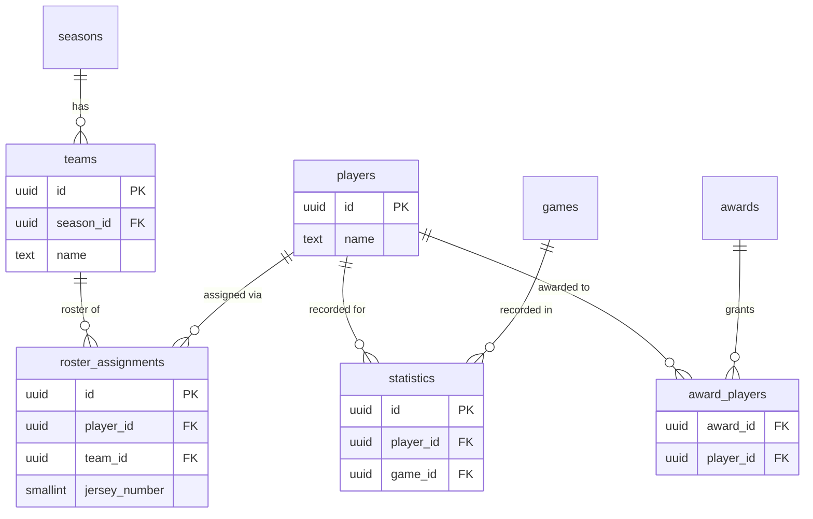
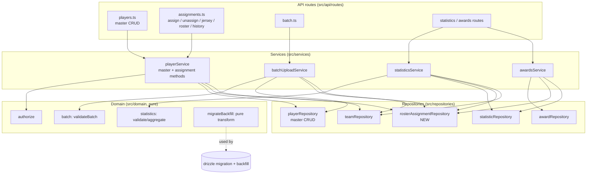

# Design Document

## Overview

This feature splits the current team-scoped `Player` into two concepts and reconciles every dependent feature with the split, without losing data or breaking existing references.

Today a `players` row is `{ id, team_id → teams, name, jersey_number }` with `unique(team_id, jersey_number)`. Statistics and award recipients reference `players.id`. A person who appears on two Teams is two unrelated rows.

The new model is:

- **Player (master)** = `{ id, name }` — a person. `name` is 1–100 chars and **not** unique. No team, no jersey.
- **Roster_Assignment** = `{ id, player_id → players, team_id → teams, jersey_number }` — links one master Player to one Team (and, because a Team belongs to exactly one Season, to one Season) with a jersey number. Jersey lives here, not on the Player.

Two invariants govern assignments:

1. **Jersey uniqueness within a Team** — enforced by a DB `unique(team_id, jersey_number)` on `roster_assignments` (direct carry-over of today's constraint).
2. **At most one assignment per Player per Season** — a Team implies its Season, so this is "a Player holds at most one assignment among all Teams of a given Season." This has no single-column DB expression (the Season is reached through `teams.season_id`), so it is enforced in the service layer inside the create transaction. See [One-per-season enforcement](#one-per-season-enforcement) for the recommendation and its race-condition tradeoff.

The headline constraint on the whole change is **identity preservation**: `statistics.player_id` and `award_players.player_id` must keep resolving after migration. The migration therefore keeps each legacy `players.id` as the **master** Player id and moves only `team_id`/`jersey_number` out into a new `roster_assignments` row. The statistics/award FKs continue to point at `players.id`, which never changes.

This spec is backend/domain only. It layers onto the existing architecture unchanged: pure domain logic (`src/domain`), application services (`src/services`), thin repositories over Drizzle (`src/repositories`), and Express routes (`src/api/routes`). The structured error taxonomy (`src/domain/errors.ts`) and the `withTransaction`/`Executor` pattern are reused as-is. The assignment UI is delivered by the separate `management-ui` spec; the endpoint shapes here are chosen to be the clean contract that spec will consume.

### Model-split summary

| Aspect | Before | After |
| --- | --- | --- |
| Person identity | `players` row (team-scoped) | `players` row (master, `{id, name}`) |
| Team membership | `players.team_id` column | `roster_assignments.team_id` row |
| Jersey number | `players.jersey_number` column | `roster_assignments.jersey_number` column |
| Jersey uniqueness | `unique(players.team_id, jersey_number)` | `unique(roster_assignments.team_id, jersey_number)` |
| One team per person | implicit (one row per team) | one assignment per Player **per Season** (service-enforced) |
| Statistics / Awards reference | `players.id` | `players.id` (**unchanged** — preserved by migration) |

## Architecture

The relationship spine changes only around the Player. `statistics` and `award_players` keep pointing at `players.id`; the Team link moves from `players` to the new `roster_assignments` table.



Key observations driving the design:

- `statistics.player_id` and `award_players.player_id` **retain** their FK to `players.id`. No change to those tables, and no data touched — identity preservation falls out of keeping the id.
- Eligibility (statistics) and candidate pools (awards) previously read `players.team_id`. That column is gone, so the player→team mapping is now reconstructed from `roster_assignments` scoped to the relevant Season. This is the main service-layer change beyond the new assignment CRUD.

### Component layering



## Data Models

### Drizzle schema changes (`src/db/schema.ts`)

**`players` reshaped** — drop `team_id`, `jersey_number`, and the `players_team_jersey_uq` / `players_jersey_range_chk` constraints. Keep `id` and `name` with the existing 1–100 length check.

```ts
export const players = pgTable(
  'players',
  {
    id: uuid('id').primaryKey().defaultRandom(),
    // 1–100 chars; NOT unique (names are not globally unique).
    name: text('name').notNull(),
  },
  (t) => [check('players_name_len_chk', sql`char_length(${t.name}) between 1 and 100`)],
);
```

**`roster_assignments` added** — the Team link + jersey, with the carried-over uniqueness and range constraints.

```ts
export const rosterAssignments = pgTable(
  'roster_assignments',
  {
    id: uuid('id').primaryKey().defaultRandom(),
    playerId: uuid('player_id')
      .notNull()
      .references(() => players.id, { onDelete: 'restrict' }), // Req 1.8: block delete while assigned
    teamId: uuid('team_id')
      .notNull()
      .references(() => teams.id, { onDelete: 'cascade' }), // deleting a Team removes its roster
    // 0–99, unique within a Team's roster.
    jerseyNumber: smallint('jersey_number').notNull(),
  },
  (t) => [
    unique('roster_assignments_team_jersey_uq').on(t.teamId, t.jerseyNumber),
    check('roster_assignments_jersey_range_chk', sql`${t.jerseyNumber} between 0 and 99`),
  ],
);

export type RosterAssignmentRow = typeof rosterAssignments.$inferSelect;
export type NewRosterAssignmentRow = typeof rosterAssignments.$inferInsert;
```

Design decisions on the FK `onDelete` behaviors:

- `player_id` uses `onDelete: 'restrict'`. This makes the database itself a backstop for Req 1.8 (cannot delete a master Player while assigned). The service still returns a typed `ConflictError` by checking assignments first, but the restrict guards against a race.
- `team_id` uses `onDelete: 'cascade'` so deleting a Team removes its roster rows — matching the prior behavior where `players.team_id` cascaded on Team delete, and consistent with `teamRepository.delete` / Team-deletion gating (base Req 3.7).

> **`statistics` and `award_players` are untouched.** Their `player_id` FK still references `players.id`. This is the mechanism that keeps existing references valid (Req 5.1, 6.1, 7.2).

#### One-per-season enforcement

The "at most one assignment per Player per Season" rule (Req 3.2/3.3) cannot be a single-table unique constraint because the Season is reached via `teams.season_id`, not stored on `roster_assignments`.

**Recommendation: service-layer guard inside the create transaction.** When assigning, the service resolves the target Team's `season_id`, lists the Season's Teams, and checks whether the Player already holds an assignment to any of them — all inside the same `withTransaction` unit as the insert. This is the simplest approach, needs no derived column or trigger, and keeps the rule in the application layer alongside authorization and jersey checks.

- **Tradeoff (documented):** two concurrent assigns of the same Player into the same Season could both pass the check before either inserts, since the guard is a read-then-write without a DB uniqueness fence. This is the same class of race the base roster code already tolerates for jersey checks done in the service, and the deployment is single-writer-per-request with short transactions, so the window is small.
- **Alternative considered (not chosen now):** add a denormalized `season_id` column to `roster_assignments`, kept in sync at write time, with `unique(player_id, season_id)`. This closes the race at the DB level but adds a column that must be maintained in lock-step with `team_id` and complicates the migration backfill. It is noted as a hardening follow-up if contention is ever observed; the invariant and its property (Property 5) are written so this swap would not change behavior.

### Domain types (`src/domain/types.ts`)

Replace the team-scoped `Player` with a master `Player` and add `RosterAssignment`:

```ts
export interface Player {
  id: string;
  /** 1–100 chars. Not unique. */
  name: string;
}

export interface RosterAssignment {
  id: string;
  playerId: string;
  teamId: string;
  /** 0–99, unique within the Team roster. */
  jerseyNumber: number;
}

/** A roster entry as read for a Team (Player identity + jersey). */
export interface RosterEntry {
  playerId: string;
  name: string;
  jerseyNumber: number;
}

/** A player-history entry (which Team/Season and jersey). */
export interface PlayerHistoryEntry {
  assignmentId: string;
  teamId: string;
  seasonId: string;
  jerseyNumber: number;
}
```

Downstream type impact (all mechanical, no behavior change beyond the model):

- `src/repositories/mappers.ts`: `toPlayer` drops `teamId`/`jerseyNumber`; add `toRosterAssignment`.
- `EligibilityContext` / `RosterContext` in `src/domain/statistics.ts` keep their `playerTeamById` shape — **no change to the pure domain**; only the service code that *builds* those maps changes (from assignments instead of `player.teamId`).
- `FinalsCandidate` in `src/domain/finals.ts` is `{ playerId, name }` already — unchanged; only how `awardsService` builds the candidate list changes.

### Request/response payload shapes

Master Player endpoints:

| Operation | Request body | Response |
| --- | --- | --- |
| `POST /players` | `{ name: string }` | `201 { id, name }` |
| `GET /players` | — | `200 [{ id, name }]` |
| `GET /players/:playerId` | — | `200 { id, name }` |
| `PATCH /players/:playerId` | `{ name: string }` | `200 { id, name }` |
| `DELETE /players/:playerId` | — | `204` |

Assignment endpoints (team-scoped):

| Operation | Request | Response |
| --- | --- | --- |
| `POST /teams/:teamId/assignments` | `{ playerId, jerseyNumber }` | `201 { id, playerId, teamId, jerseyNumber }` |
| `PATCH /teams/:teamId/assignments/:playerId` | `{ jerseyNumber }` | `200 { id, playerId, teamId, jerseyNumber }` |
| `DELETE /teams/:teamId/assignments/:playerId` | — | `204` |
| `GET /teams/:teamId/roster` | — | `200 [{ playerId, name, jerseyNumber }]` |
| `GET /players/:playerId/history` | — | `200 [{ assignmentId, teamId, seasonId, jerseyNumber }]` |

See [API routes](#api-routes-srcapiroutes) for method/path rationale and error cases.

## Migration Design

### Goal and guarantee

Convert every legacy `players` row `{ id, team_id, name, jersey_number }` into:

- one **master** `players` row `{ id, name }` that **keeps the same `id`**, and
- one `roster_assignments` row `{ id: new, player_id: <legacy id>, team_id, jersey_number }`.

**Id-preservation guarantee:** for every legacy row, `master.id === legacy.id` and `assignment.player_id === legacy.id`. Therefore every `statistics.player_id` and `award_players.player_id` continues to resolve with zero changes to those tables (Req 5.1, 6.1, 7.2). This is the central correctness claim of the migration and is captured as Property 13.

### Schema deltas and ordering

The change is produced with the standard workflow: edit `src/db/schema.ts`, run `drizzle-kit generate` (`npm run db:generate`) to emit a new timestamped SQL file under `./drizzle` (next tag after `0001_motionless_black_queen`), then apply with `npm run db:migrate` (the runner in `src/db/migrate.ts`, which calls Drizzle's `migrate` over `./drizzle`).

The generated migration must execute in this safe order; the **backfill is embedded as SQL statements inside the generated migration file** (justified below), between create and drop:

1. **Create** `roster_assignments` (table, FKs, `unique(team_id, jersey_number)`, jersey range check).
2. **Backfill** one assignment per existing `players` row from `players.team_id` / `players.jersey_number`:

   ```sql
   -- Idempotent: only backfills rows not already represented, and only while the
   -- legacy columns still exist (i.e. this migration has not completed before).
   INSERT INTO roster_assignments (id, player_id, team_id, jersey_number)
   SELECT gen_random_uuid(), p.id, p.team_id, p.jersey_number
   FROM players p
   WHERE NOT EXISTS (
     SELECT 1 FROM roster_assignments ra WHERE ra.player_id = p.id
   );
   ```
3. **Drop** the old `players` constraints and columns:

   ```sql
   ALTER TABLE players DROP CONSTRAINT IF EXISTS players_team_jersey_uq;
   ALTER TABLE players DROP CONSTRAINT IF EXISTS players_jersey_range_chk;
   ALTER TABLE players DROP COLUMN IF EXISTS jersey_number;
   ALTER TABLE players DROP COLUMN IF EXISTS team_id;
   ```

Because `players.id` is never rewritten and the `statistics`/`award_players` FK columns are never touched, those references stay intact throughout (no FK is dropped or re-pointed).

### Idempotency (Req 7.5)

Drizzle's migrator records applied migrations in its journal, so a normal re-run of `npm run db:migrate` is already a no-op. Beyond that, the migration body is defensive so it is safe even if replayed against a partially-migrated database:

- The backfill `INSERT ... WHERE NOT EXISTS` guards against double-backfill: a Player that already has an assignment is skipped, so running the backfill twice inserts nothing the second time (`f(f(x)) = f(x)`).
- `DROP ... IF EXISTS` makes the column/constraint drops safe to repeat.
- After the columns are dropped, the backfill `SELECT ... FROM players` referencing `p.team_id` would no longer be valid, which is why the backfill runs **before** the drop and is bundled with it in one migration file (so the two steps are never half-applied by the journal).

### Why embed the backfill in the generated migration (not a one-off script)

A single migration file that creates the table, backfills, and drops the columns is **atomic under one journal entry and runs on every environment through the existing `db:migrate` path** — no extra command, no risk of someone running the schema change but forgetting the data step. A separate `src/db/backfill.ts` script would be ordering-fragile (must run after create but before drop) and easy to skip. The only caveat is that `drizzle-kit generate` emits DDL only, so the `INSERT ... SELECT` backfill block is **added by hand** to the generated file between the create and drop statement-breakpoints. This hand-edit is small, reviewable, and testable because the row transform is extracted as a pure function (below).

### Pure, testable backfill transform

To make the migration logic unit/property-testable **without a database**, the row mapping is extracted into a pure function in `src/db/migrateBackfill.ts`:

```ts
export interface LegacyPlayerRow { id: string; teamId: string; name: string; jerseyNumber: number; }
export interface BackfillOutput {
  players: { id: string; name: string }[];
  assignments: { playerId: string; teamId: string; jerseyNumber: number }[];
}
/** Pure: legacy rows → master players (id preserved) + one assignment each. */
export function backfillPlayers(rows: readonly LegacyPlayerRow[]): BackfillOutput;
```

The embedded SQL mirrors this function exactly. Properties 12–14 test `backfillPlayers` directly (losslessness, id-preservation, idempotence), giving DB-free confidence that the SQL is correct; an optional DB-backed integration test (Testing Strategy) exercises the actual migration end-to-end.

### Seed update (`src/db/seed.ts`)

Seed only creates an admin user and a starter League today, so it needs no change for the model split. If future seed rows add players, they must create a master Player then an assignment (noted for the tasks phase, not required here).

## Components and Interfaces

### `playerRepository` (reshaped, `src/repositories/teamRepository.ts` or a new `playerRepository.ts`)

Master CRUD only — no team/jersey. Keeps the thin `Executor`-based style.

```ts
playerRepository = {
  create(input: { name: string }, ex): Promise<Player>,         // {id, name}
  createMany(inputs: { name: string }[], ex): Promise<Player[]>, // batch
  findById(id, ex): Promise<Player | null>,
  list(ex): Promise<Player[]>,                                   // Req 1.7
  update(id, patch: { name?: string }, ex): Promise<Player | null>,
  delete(id, ex): Promise<boolean>,
}
```

`listByTeam` moves off `playerRepository` (it was team-scoped) and is replaced by roster reads on the new repository.

### `rosterAssignmentRepository` (new, `src/repositories/rosterAssignmentRepository.ts`)

```ts
rosterAssignmentRepository = {
  create(input: { playerId, teamId, jerseyNumber }, ex): Promise<RosterAssignment>,
  createMany(inputs, ex): Promise<RosterAssignment[]>,            // batch import
  findByPlayerAndTeam(playerId, teamId, ex): Promise<RosterAssignment | null>,
  listByTeam(teamId, ex): Promise<RosterAssignment[]>,           // roster
  listByPlayer(playerId, ex): Promise<RosterAssignment[]>,       // history
  listByPlayerInSeason(playerId, seasonId, ex): Promise<RosterAssignment[]>, // one-per-season check
  updateJersey(assignmentId, jerseyNumber, ex): Promise<RosterAssignment | null>,
  delete(assignmentId, ex): Promise<boolean>,
}
```

`listByPlayerInSeason` joins `roster_assignments → teams` on `teams.season_id = :seasonId` so the one-per-season guard reads exactly the Player's assignments within the target Season. Repositories stay data-access-only; no business rules.

### `playerService` (reworked, `src/services/playerService.ts`)

Split into **master Player methods** and **assignment methods**, preserving the existing "authorize first, then validate, then check conflicts, write nothing on rejection" discipline and the `authorize()` delegation.

Master Player methods (Administrator-scoped — these are not team-scoped, so they use `authorize(user, action, { kind: 'admin' })`):

- `createPlayer(user, { name }, ex)` — authorize; validate name 1–100 (Req 1.2); create (duplicate name allowed, Req 1.3); return `{id, name}` (Req 1.1).
- `getPlayer(user, { playerId }, ex)` — `NotFoundError` if absent (Req 1.5); return `{id, name}` (Req 1.4).
- `listPlayers(user, ex)` — return all masters (Req 1.7).
- `updatePlayer(user, { playerId, name }, ex)` — exist-check (Req 1.5); validate name (Req 1.2); update name; assignments untouched (Req 1.6).
- `removePlayer(user, { playerId }, ex)` — exist-check (Req 1.5); if `listByPlayer` is non-empty → `ConflictError` (Req 1.8); else delete (Req 1.9). Runs in a transaction so the count-then-delete is consistent; the DB `restrict` FK is the backstop.

Assignment methods (team-scoped — `authorize(user, action, { kind: 'team', teamId })`, mirroring the current roster rules, Req 2.2/9.2):

- `assignPlayer(user, { teamId, playerId, jerseyNumber }, ex)` — order of checks:
  1. **Authorize** on `teamId` first → `AuthorizationError` with no reads, so existence is not disclosed (Req 2.3).
  2. **Validate** jersey 0–99 integer → `ValidationError` (Req 2.4).
  3. In a transaction: Team exists? → `NotFoundError(Team)` (Req 3.5). Player exists? → `NotFoundError(Player)` (Req 3.4).
  4. **Jersey uniqueness**: `listByTeam(teamId)` must not already use `jerseyNumber` → `ConflictError` (Req 3.1).
  5. **One-per-season**: resolve `team.seasonId`; `listByPlayerInSeason(playerId, seasonId)` must be empty → `ConflictError` same-season (Req 3.2); a different-Season assignment passes (Req 3.3).
  6. Create and return the assignment (Req 2.1).
- `unassignPlayer(user, { teamId, playerId }, ex)` — authorize on team; find assignment by `(playerId, teamId)`; absent → `NotFoundError` (Req 2.6); else delete, retaining the master Player and the Player's other assignments (Req 2.5).
- `updateAssignmentJersey(user, { teamId, playerId, jerseyNumber }, ex)` — authorize on team; find assignment (`NotFoundError` if absent); validate range (Req 2.4); jersey free on the roster excluding this assignment → else `ConflictError` (Req 3.1); update (Req 2.7).

Read methods:

- `getTeamRoster(teamId, ex)` — join assignments to master names → `[{ playerId, name, jerseyNumber }]`; empty Team yields `[]` with no error (Req 4.1, 4.2).
- `getPlayerHistory(playerId, ex)` — assignments joined to `teams.season_id` → `[{ assignmentId, teamId, seasonId, jerseyNumber }]` (Req 4.3).

### `statisticsService` changes (`src/services/statisticsService.ts`)

The pure `validateStatistic` / `aggregateStatistics` are unchanged. Only the construction of `playerTeamById` moves from `player.teamId` to assignments:

- `buildEligibilityContext(game, ex)` — build `playerTeamById` from `rosterAssignmentRepository.listByTeam(homeTeamId)` and `listByTeam(awayTeamId)`, mapping each assignment's `playerId → teamId`. A Player eligible iff they hold an assignment to the home or away Team for the Game's Season (both Teams belong to the Game's Season) (Req 5.2, 5.3).
- `getPlayerSeasonStats` — replace `player.teamId` with the Player's assignment in that Season: `listByPlayerInSeason(playerId, seasonId)` → the single `teamId` (or none) for `playerTeamById` (Req 5.4).
- `getTeamSeasonStats` — replace `playerRepository.listByTeam(teamId)` with `rosterAssignmentRepository.listByTeam(teamId)` to build the roster map (Req 5.4).

### `awardsService` changes (`src/services/awardsService.ts`)

- `loadPlayerNames` still reads `playerRepository.findById` (master names) — unchanged.
- `computeFinalsMvpForScope` currently builds the champion candidate pool from `playerRepository.listByTeam(championTeamId)`. Replace with `rosterAssignmentRepository.listByTeam(championTeamId)` joined to master names → `FinalsCandidate { playerId, name }`, so recipients are considered by their assignments within the scope's Season (Req 6.2). The pure `computeFinalsMvp` / `computeRegularSeasonAwards` are unchanged, so award references remain master-Player ids (Req 6.1).

### `batchUploadService` changes (`src/services/batchUploadService.ts`)

`validateBatch` (pure) is unchanged — same all-or-nothing semantics and per-row report (Req 8.2). Only `importRows` changes:

- After creating/deduplicating Teams, for **each row** create a **new master Player** `{ name }` (never reuse an existing master, Req 8.3), then create a `roster_assignment` linking that new Player to the row's Team with the row's jersey.
- All writes stay in one `withTransaction` unit (all-or-nothing, Req 8.1/8.2).
- Result shape stays `{ teamsCreated, playersCreated, importedRecords }`; `playersCreated` now counts master Players (one per row) and the assignments created equal the rows. (The existing test's expected `createMany` call shape changes from `{teamId,name,jerseyNumber}` to a master create `{name}` plus an assignment create — the test is updated accordingly in the tasks phase.)

### API routes (`src/api/routes/`)

Split today's `players.ts` into **master Player** routes and **assignment** routes. Both keep `authenticate()` + the central `errorHandler` mapping typed errors to status codes. RESTful shapes chosen so `management-ui` gets clean, predictable endpoints:

- `players.ts` (master, Administrator-scoped via `authorizeRequest('…', () => ({ kind: 'admin' }))`):
  - `POST /players` `{name}` → `201 {id,name}`
  - `GET /players` → `200 [{id,name}]`
  - `GET /players/:playerId` → `200 {id,name}` / `404`
  - `PATCH /players/:playerId` `{name}` → `200` / `400` / `404`
  - `DELETE /players/:playerId` → `204` / `404` / `409` (still assigned)
  - `GET /players/:playerId/history` → `200 [{assignmentId,teamId,seasonId,jerseyNumber}]`
- `assignments.ts` (team-scoped — the Team id is in the path, so a request-time `authorizeRequest('…', req → ({kind:'team', teamId: req.params.teamId}))` guard applies, and the service re-checks):
  - `POST /teams/:teamId/assignments` `{playerId,jerseyNumber}` → `201` / `400` / `403` / `404` / `409`
  - `PATCH /teams/:teamId/assignments/:playerId` `{jerseyNumber}` → `200` / `400` / `403` / `404` / `409`
  - `DELETE /teams/:teamId/assignments/:playerId` → `204` / `403` / `404`
  - `GET /teams/:teamId/roster` → `200 [{playerId,name,jerseyNumber}]`

Because the Team id is in the assignment path (unlike today's body-based `teamId` on `POST /players`), the authorization scope is known up front for every assignment route, which is cleaner than the current update/remove path that could only authorize after loading the record.

## Correctness Properties

*A property is a characteristic or behavior that should hold true across all valid executions of a system — essentially, a formal statement about what the system should do. Properties serve as the bridge between human-readable specifications and machine-verifiable correctness guarantees.*

The set below was reduced from the per-criterion prework by folding complementary cases (create/read, same-/cross-season, duplicate-/free-jersey, eligible-/ineligible) into single comprehensive properties, and by realizing the identity guarantees (5.1, 6.1, 9.4) through the migration properties rather than duplicating them. Authorization reuses the already-property-tested pure `authorize`, so only the non-disclosure behavior specific to this spec is asserted here.

### Property 1: Master Player identity shape and non-unique names

*For any* name of length 1–100 (including a name identical to an existing Player's), creating a master Player yields a record `{id, name}` with a fresh unique id, no team and no jersey, and creating two Players with the same name yields two distinct ids without error.

**Validates: Requirements 1.1, 1.3, 1.4**

### Property 2: Rename preserves assignments

*For any* master Player holding any set of Roster_Assignments, updating the Player's name to a valid 1–100 value changes only the name and leaves that Player's set of assignments identical.

**Validates: Requirements 1.6**

### Property 3: Deletion gating

*For any* master Player, deletion succeeds and removes the Player if and only if the Player holds zero Roster_Assignments; when one or more assignments exist, deletion is rejected with a ConflictError and neither the Player nor any assignment is removed.

**Validates: Requirements 1.8, 1.9**

### Property 4: Jersey uniqueness within a Team

*For any* Team roster and any assign-or-update operation, the operation is rejected with a ConflictError when the chosen jersey number is already used by a different assignment on that Team, and accepted when the number is a free integer in 0–99; on rejection no assignment is created or changed.

**Validates: Requirements 2.7, 3.1**

### Property 5: One assignment per Player per Season (cross-Season allowed)

*For any* master Player and any Team, assigning the Player to that Team is rejected with a ConflictError when the Player already holds an assignment to any Team in that Team's Season, and accepted (all other checks passing) when the Player's existing assignments are only in other Seasons; on rejection no assignment is created.

**Validates: Requirements 3.2, 3.3**

### Property 6: Unassign isolation

*For any* master Player holding at least one assignment, unassigning the Player from one Team removes exactly that assignment and retains the master Player together with all of the Player's assignments to other Teams.

**Validates: Requirements 2.5**

### Property 7: Authorization non-disclosure

*For any* assign or unassign request the acting user is not authorized to perform, the System returns an AuthorizationError and leaves all assignments unchanged, and the response is identical whether or not the target Player or assignment exists.

**Validates: Requirements 2.2, 2.3, 3.6, 9.2**

### Property 8: Roster read shape (including empty)

*For any* Team, reading the Team's Roster returns exactly one entry `{playerId, name, jerseyNumber}` per Roster_Assignment on that Team (with the master Player's name), and returns an empty list with no error when the Team has no assignments.

**Validates: Requirements 4.1, 4.2**

### Property 9: Player history shape

*For any* master Player, reading the Player's history returns exactly one entry per Roster_Assignment, each identifying the Team, that Team's Season, and the jersey number.

**Validates: Requirements 4.3**

### Property 10: Assignment-based eligibility

*For any* completed Game and any Player, recording a Statistic is accepted if and only if the Player holds a Roster_Assignment to the home or away Team for the Game's Season; an ineligible Player is rejected with a ValidationError and any previously recorded Statistic is retained.

**Validates: Requirements 5.2, 5.3**

### Property 11: Assignment-based aggregation attribution

*For any* set of recorded Statistics and any Season's Roster_Assignments, each Player's season total per Statistic_Type equals the sum of that Player's recorded values of that type, and each Team's season total equals the sum over the Players assigned to that Team for the Season via their assignments.

**Validates: Requirements 5.4**

### Property 12: Migration losslessness and post-conditions

*For any* set of legacy team-scoped player rows that satisfied the old constraints, the backfill transform produces exactly one master Player and exactly one Roster_Assignment per row, preserving every name, team, and jersey number, and the resulting assignments satisfy jersey uniqueness within each Team and at most one assignment per Player per Season.

**Validates: Requirements 7.1, 7.3, 7.4, 9.4**

### Property 13: Migration id-preservation round trip

*For any* legacy player row, the master Player produced by the backfill has an id equal to the legacy row's id and the produced Roster_Assignment references that same id, so every Statistic and Award recipient reference that pointed to the legacy id still resolves to the migrated master Player.

**Validates: Requirements 5.1, 6.1, 7.2**

### Property 14: Migration idempotence

*For any* legacy dataset, applying the guarded backfill twice produces the same result as applying it once (the second application creates no additional master Players or Roster_Assignments).

**Validates: Requirements 7.5**

### Property 15: Batch creates a new master and assignment per row

*For any* accepted Batch_Upload, the import creates exactly one new master Player and exactly one Roster_Assignment per row (linking that new Player to the row's Team with the row's jersey) and creates each distinct Team once; two rows with identical player names produce two distinct master Players.

**Validates: Requirements 8.1, 8.3**

## Error Handling

All failures use the existing taxonomy in `src/domain/errors.ts`; no new categories. Services write nothing on any rejection (Req 3.6), enforced by authorizing/validating before the transaction and by rolling back inside it.

| Condition | Error | HTTP | Requirements |
| --- | --- | --- | --- |
| Player/jersey name or number out of range, non-integer jersey | `ValidationError` | 400 | 1.2, 2.4 |
| Statistic for a Player not assigned to a participating Team | `ValidationError` | 400 | 5.3 |
| Caller not authorized for the Team (assign/unassign/jersey) | `AuthorizationError` | 403 | 2.3, 9.2 |
| Unknown Player, Team, or assignment | `NotFoundError` | 404 | 1.5, 2.6, 3.4, 3.5 |
| Duplicate jersey within a Team | `ConflictError` | 409 | 3.1 |
| Player already assigned in the same Season | `ConflictError` | 409 | 3.2 |
| Delete a Player that still holds assignments | `ConflictError` | 409 | 1.8 |
| Any invalid batch row | `BatchValidationError` (per-row report) | 422 | 8.2 |

Non-disclosure: assignment routes authorize on the path `teamId` before any Player/assignment read, so an unauthorized caller receives the same `AuthorizationError` regardless of whether the target exists (Property 7, Req 2.3).

## Testing Strategy

The project runs on Vitest with DB-less service/route tests (stub `db.transaction`, spy repositories — see `batchUploadService.test.ts`) and pure domain tests. The change keeps typecheck, lint, build, and tests green (Req 9.3).

**Dual approach:**

- **Property-based tests** (library: `fast-check` with Vitest, min 100 iterations each, tagged `Feature: player-master-data, Property N: <text>`) for the universal properties — chiefly the pure, DB-free ones: the backfill transform (Properties 12–14), assignment-based eligibility and aggregation over generated maps (Properties 10, 11), and the service invariants exercised against stubbed repositories (Properties 1–9, 15).
- **Unit/example tests** for specific not-found and authorization cases (Req 1.5, 2.6, 3.4, 3.5, 2.2), batch all-or-nothing rejection (Req 8.2, mirroring the existing test), and the awards candidate-pool derivation (Req 6.2).

**Service/route tests without a DB:** reuse the existing stub pattern — a `db.transaction` that invokes the callback with a marker tx, and `vi.spyOn` on `playerRepository` / `rosterAssignmentRepository` to assert what would be written (and that nothing is written on rejection). Route tests use `supertest` against the Express app with stubbed services, following `publicAwards.test.ts`.

**Migration testing (recommendation):** the risky logic is the row transform, so it is **extracted as the pure `backfillPlayers` function** and covered by Properties 12–14 with no database needed — this is the primary, always-run safety net. An **optional** DB-backed integration test (gated on a `DATABASE_URL`, skipped in CI without one) can apply the generated migration to a seeded legacy dataset and assert row counts, field preservation, and that a sample `statistics`/`award_players` reference still joins — exercising the hand-added SQL end-to-end. Because the SQL mirrors the pure function one-to-one, the pure properties give high confidence even where a live DB is unavailable.

## Requirements Coverage

| Requirement | Design sections |
| --- | --- |
| 1. Master Player entity & CRUD | Data Models (`players` reshaped, domain `Player`); `playerRepository`; `playerService` master methods; API master routes; Properties 1–3; Error Handling |
| 2. Roster assignment (assign/unassign) | `rosterAssignmentRepository`; `playerService` assignment methods; API assignment routes; Properties 4, 6, 7; Error Handling |
| 3. Assignment constraints & error taxonomy | Data Models (`roster_assignments` constraints, One-per-season enforcement); `playerService` check ordering; Properties 4, 5, 7; Error Handling table |
| 4. Roster & player history reads | Domain `RosterEntry`/`PlayerHistoryEntry`; `rosterAssignmentRepository.listByTeam/listByPlayer`; `playerService.getTeamRoster/getPlayerHistory`; API roster/history routes; Properties 8, 9 |
| 5. Statistics continuity | Architecture (player→team from assignments); `statisticsService` changes; Properties 10, 11, 13 |
| 6. Awards continuity | `awardsService` changes (candidate pool from assignments); Properties 13 (id preservation), and 6.2 via example |
| 7. One-time lossless migration | Migration Design (schema deltas, ordering, idempotency, id preservation, pure `backfillPlayers`); Properties 12, 13, 14 |
| 8. Batch upload reconciled | `batchUploadService` changes; `validateBatch` unchanged; Property 15; Error Handling (BatchValidationError) |
| 9. Non-functional & architectural | Overview/Architecture (layering, taxonomy reuse, `withTransaction`); Property 7 (authorization), Property 12 (no data loss); Testing Strategy (typecheck/lint/build/tests) |
```